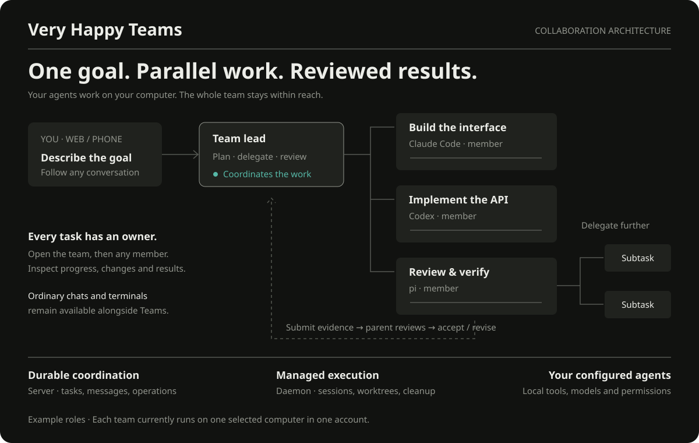
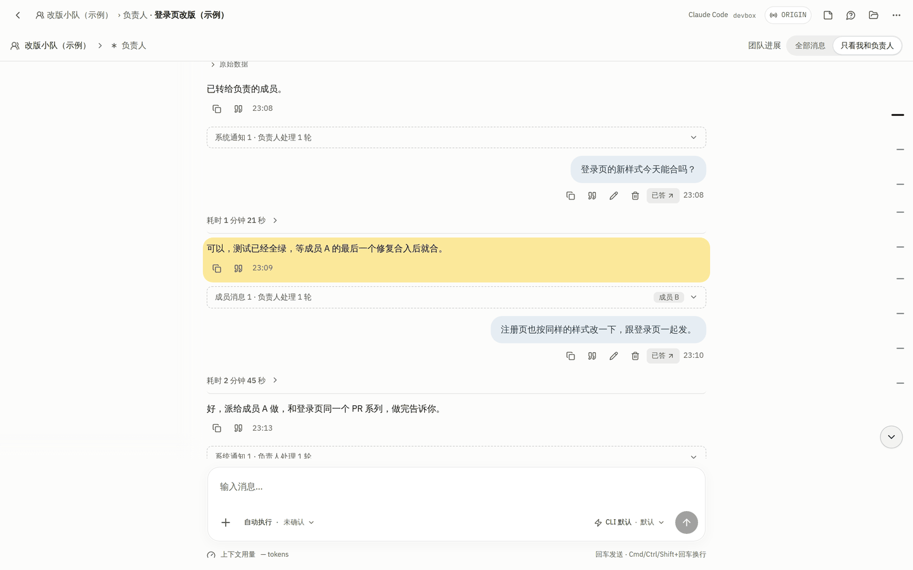
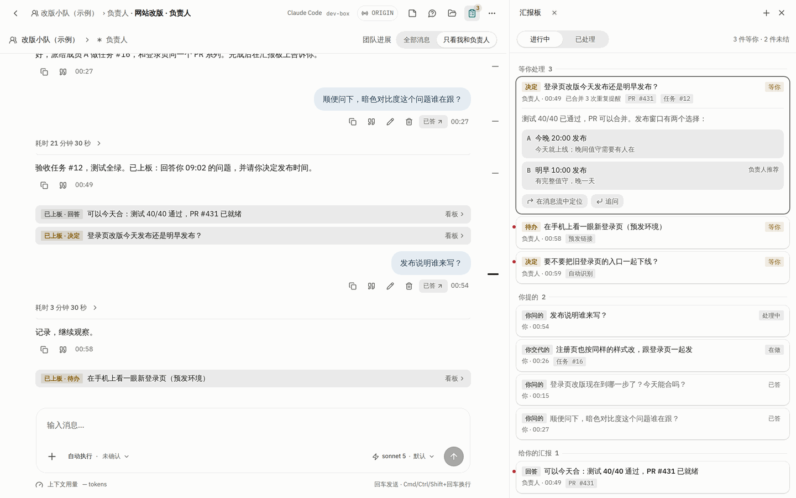
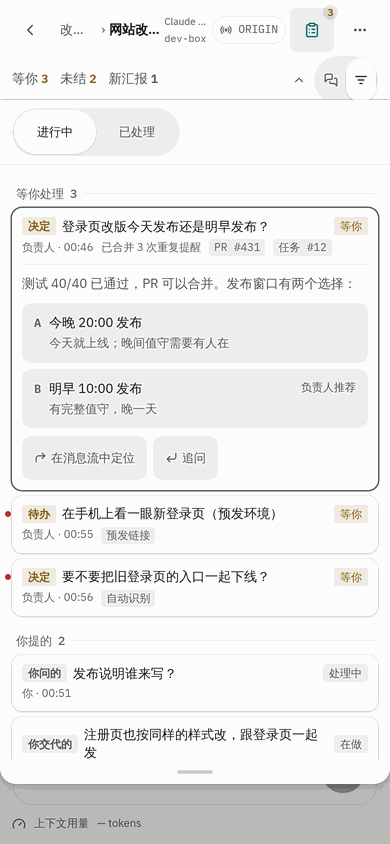

# Very Happy Teams

Give a coding agent a goal and let it organize a team. A lead can delegate
independent tasks to Claude Code, Codex, or pi teammates, follow their progress,
and bring their results back for review. Teammates can delegate child tasks within
their own assignments. You can inspect any member conversation along the way.



Teams is optional. Ordinary conversations, terminals, and history keep working as
before. Each team currently uses one account and one execution computer; automatic
cross-machine routing is not available.

## Prerequisites

- The operator enables `VH_AGENT_TEAMS_ENABLED=true`; every account on that
  server can then use Teams (B-502 removed the per-account allowlist). Each
  account may hold 32 non-archived teams.
- The selected machine runs a compatible, online daemon advertising Teams
  capability. Update the CLI and hand over with `very-happy daemon start`; start
  a new managed session to use the new runner tools. Existing wrappers are not
  upgraded in place.
- Configure each coding agent's normal credentials. Teams does not grant provider access.
  Owners choose approval behavior in the team execution settings.
- Use a Git checkout for automatic isolated worktrees. Preserve and integrate
  changes before cleanup; a worktree with uncommitted files or commits that are
  not pushed or merged is intentionally retained.

An unavailable/disabled server reports that state. An old daemon cannot receive a
Teams delegation; it does not fall back to Claude or the legacy assistant.

## Start a team in the app

Choose **Teams → New team**, select the working folder and execution computer,
and describe the goal. The team goes into a new project with its name unless you
pick an existing project or *No project*; the project's instructions and log are
the team's shared context (see [Projects](projects.md#teams-and-projects)). A compatible daemon starts a managed lead in an isolated
worktree, supplies the official skill, and opens the lead conversation. App users
do not install skills manually. The lead lives for this goal; after acceptance its
session can be cleaned up, while unmerged changes remain preserved.

You only talk to the lead. The lead splits the goal into tasks, creates members
as it needs them, follows their progress and reviews their results; you do not
add members yourself. Until the lead creates one, the team page and the expanded
sidebar team say so, with a link into the lead's conversation, and the ⓘ beside
**Who is working** explains the split.

### Just me & the lead

The lead's conversation also carries the members' submissions, progress and
questions, the system's idle / queue notices and everything the lead does in
reply — in a busy team most of the transcript. The team row above the lead's
conversation therefore has a switch: **All messages | Just me & the lead**
(「全部消息 | 只看我和负责人」; on a phone **All | Me & lead**). *Just me & the
lead* is the default, and the choice is remembered per conversation on this
device.

In *Just me & the lead* your messages and the lead's turns that answer them stay
as they are. Each run of member messages, system notices and the lead's turns
handling them becomes one dashed line such as *3 member messages · 1 system
notice · lead handled 3 turns* with chips for the members who wrote; click it to
expand the run in place (**Collapse N** folds it again). New member traffic lands
inside the last line, so a reader who scrolled back is not moved and the
↓ counter only counts what is on screen. Your message shows **Answered ↗** once
the lead has written text in reply to it; click it to jump to that answer, which
is briefly highlighted.

What is "yours" comes from transport fields, never from the wording: a team
message is classified by its team record (`source`, sender), a background-task
notice or automation / assistant prompt is a system notice, a message from
another session counts as a member, and anything typed by a person (web, phone,
desktop, terminal, a shared-session guest) is yours. Ordinary conversations and
members' conversations have no switch. Rules: `screens/session/leadView.ts`.



### Briefing (汇报板)

The lead's conversation also has a **Briefing** (「汇报板」): one fixed place for
what is waiting on you, so a decision is not re-posted in the transcript every
time it comes up. Open it with the board button in the session header (its
badge counts only what waits on you); on a wide screen it is a tab in the right
panel (`?panel=board`), on a phone a one-line summary under the header —
*Needs you 2 · Open 2 · New 1* — that drops the board down from the top, with
the *All | Me & lead* switch at the end of the same row.

- **Needs you** — decisions (pick an option to decide), to-dos, and blocks the
  lead raised with `request_human`. An item marked *Auto-detected* was drafted
  from the lead's text without the lead posting it; it still counts as waiting.
- **You asked** — every message you sent the lead, as a question or a request,
  with its state (*Unanswered*, *In progress*, *Answered* / *Working*, *Done*)
  and the lead's first reply and answer. Answered ones stay for the latest two.
- **For you** — the lead's reports and answers, and messages you pinned.

**Active | Handled** switches between what is still open and what is settled
(with the lead's note when the lead closed it). *Show in conversation* jumps to
the message an item came from and tints it; *Follow up* quotes the item into the
composer. Picking an option also sends the choice as your message
(「［汇报板 · 决定］… → B. …」), so the lead gets it as a normal turn. Where the
lead posted an item, the transcript keeps a one-line *On Briefing · Decide*
pointer (also in *Just me & the lead*); *Briefing ›* opens the item.

A conversation with something on its Briefing that waits on you counts as
*needs you* everywhere else too: its sidebar row, the team and project tree
badges and the project pages (one per conversation, however many items). When an
agent asks for a person (`request_human`), the **Needs you** strip on that
conversation now comes from its open *Blocked* item: it is still there after a
refresh and closes when the item is resolved; decisions and to-dos stay on the
Briefing instead of adding a second strip. Opening an item marks it read on all
your devices.

The Briefing is stored by the server in plain text (same tier as teams and
projects) and appears only when the server enables it
(`VH_OWNER_BOARD_ENABLED`, see [configuration](configuration.md)) and the
conversation has items or runs a CLI with the board tools. Contract:
[owner briefing spec](../specs/2026-10-owner-briefing.md); Web rules:
`screens/session/board/boardModel.ts`.




In the sidebar's **By project** tree a team sits inside its project, beside the
project's own sessions (teams outside every project are under **Not in a
project**). Select a team's name (or press Enter) to open its team page — goal,
progress, members and results. The row shows how many of its members need you
(waiting or unread), or its head count when none do, and a spinner while any
member runs. The chevron (or → / ←) expands the member list without navigating;
its **Lead** row (crown) opens the lead's conversation, member rows read
*name · task*. A team starts folded and opens while its page or one of its
conversations is open; your own folding is remembered on this device. The row's
right-click menu (a bottom sheet on a phone's long-press) offers **Open team
page**, **Chat with the lead**, **Team settings** and expand / collapse.
In **By tag** and **Recent** there are no team rows: the lead's conversation is
listed with a team chip, and a member's only while it waits for you.
Members no longer in use fold into one **N inactive** row, both under the expanded
team in the sidebar and in the team page's member list; open it to reach their
history (this device remembers the choice, shared by both places). A member is
inactive when nothing is assigned to it (no queued, running or submitted task) and
its conversation is archived, it has stopped or exited, or it has had no activity
for 7 days. Member counts leave inactive members out; the lead never folds, and a
member whose cleanup has not finished shows **Cleanup needs attention** instead.
Inactive members can still receive work through **Transfer to** in task details.
On the team page's workspace, the **Finished** lane (done and cancelled tasks)
folds into one **Finished · N** row so long-lived teams keep their live lanes in
view; open it with a click, Enter or Space, and this device remembers the choice
for each team. An open lane shows the 20 most recently finished tasks first, and
**Show more** adds 20 at a time. Queued, In progress and Review never fold.
Each task card, the team goal, the task details, the team list card and the task
pill in chat show one derived status (B-761, `screens/teams/teamTaskState.ts`):
**Running** only while the member's session has an active turn (or a running
sub-agent / background task), **Idle · awaiting reply** when its turn ended
without a submission, **Needs approval** on a pending permission prompt, and
**Stopped · needs attention** when its session is no longer running but the task
was never submitted — the details then link the member's conversation, next to
Transfer to and Cancel. A status the page cannot see yet reads **Checking status**,
never Running. Queued work reads Queued / Starting / Launch failed.
Every conversation a team has had stays under that team in the project tree: the lead, sub-members, adopted leads and each earlier session of a
reused member. Earlier sessions fold into the **N inactive** row. Membership comes
only from the team's own records (live bindings, launch receipts and rebind
history), never from titles or folders. A conversation that leads two teams, such
as a lead that created a second team, sits under the newer one; the other team's
row still opens it.
Ordinary conversations are never automatically turned into teams. Appearance
settings can hide the Teams entry without stopping or deleting existing work.

A team can belong to a [project](projects.md): on the project page open
**Project settings → Teams** and attach it (only teams whose computer has one of
the project's folders are offered). The team's sessions are then listed as
project members, and the team appears under the project in the sidebar tree. Team members get the project instructions as background and
coordinate through their lead rather than messaging other project sessions.
The team page header shows where the team sits (*Project › Team*, or
*Teams › Team* without a project), and a member's conversation shows
*Project › Team › member · task*; each earlier step is a link. To change a
team's project use **Move to another project…** in the sidebar team row's menu
or the team page's ⋯ menu, or **Team settings → Project**.

For an existing managed conversation, use **More → Start a team from this
conversation**. Its wrapper establishes the scoped connection and delivers the
collaboration instructions in the background. No session ID entry or additional
join step is required. Old wrappers without the capability need a new session.

A member whose task was accepted or cancelled and whose cleanup finished is
**inactive**: it no longer counts as a member, its tasks and sessions stay
readable, and a new delegation with the same agent, model and folder reuses it
instead of adding another member. Delegating to a member that is still being
cleaned up queues the task; it starts once the cleanup completes. Delegating to an
inactive member by name reactivates it in a fresh session and worktree. The
member limit (32) counts active members only.

Team options choose the default agent/model for new assignments and the maximum
number of concurrently progressing leaf tasks. The harness select lists only the
harnesses the team's computer can run (Claude Code, Codex, pi; Gemini is not a
team harness yet), and the default model is a select built from that harness's
models on the computer — the bundled list, models published by pi sessions, and
the computer's custom models (**Settings → Models & providers**) — with
"Follow the harness default" first. Switching the harness resets the model; a
saved model that is no longer listed stays selected and is flagged. When the lead
delegates without `assistant`/`model`, the new member uses these defaults; the
new-team form's harness and model become the first defaults. A parent waiting for unfinished
children yields its slot; this is a work limit, not an OS-process limit. Running
members keep their original model configuration. The current team still uses one
execution computer.

Use a distinct request ID per action and reuse it with identical arguments after
an unknown outcome. Never copy scope tokens into prompts or personal settings.

## Optional: start from a terminal

```sh
very-happy teams install --host claude
# Inspect the reported destination and action, then apply:
very-happy teams install --host claude --apply
# --host codex and --host pi expose the same shared method.
```

All hosts use the one Very Happy-owned skill at
`~/.local/share/very-happy/skills/very-happy-teams/SKILL.md`. The command returns
its absolute path. Ask your managed coding agent to read that path. Installation
does not edit host discovery settings or promise automatic skill discovery; it
does not write through your shared personal skills tree. Edited/unowned files are
not silently overwritten. Uninstall uses the same ownership checks:

```sh
very-happy teams uninstall --host claude
very-happy teams uninstall --host claude --apply
very-happy teams doctor --host pi
```

Doctor describes static setup and relevant environment overrides; it is not a
live model/daemon connectivity test. Reading a skill alone does not attach an
unmanaged process. In particular, use `very-happy pi` for the managed pi path;
a bare `pi` terminal does not gain a background inbox from installation.

## Choose execution mode

New teams default to **No approvals** for the lead and newly dispatched members.
Choose **Ask when needed** in team settings to restore routine tool prompts. Existing
teams keep their saved mode (historical teams without a mode use normal approvals).
The choice takes effect directly, without a second confirmation. Existing sessions
and already queued operations retain their prior mode; change a live lead's session
mode separately. This does not change global agent settings or provide credentials.

An independent owner terminal can make the same choice:

```sh
very-happy teams permissions --team-id TEAM_ID --mode bypassPermissions --request-id UNIQUE_REQUEST_ID
```

Reuse the request ID on retries. Scoped agent tools cannot change this owner setting.
Team messages appear as compact cards; expand one to inspect the original instructions.

## Scheduled instructions

The Teams page can create a one-time or recurring message to a named bot on the
team machine. Enter a local first-run time and, for repetition, an interval in
whole minutes (minimum one minute). Server state survives daemon restarts; the
daemon delivers to the bound bot, not the most recently active session.

Pause/resume/cancel are version-checked. Cancelling cannot recall a message whose
delivery has already started, and delivery is not proof that the model processed
the instructions. An unavailable recipient retains its pending work rather than
falling back to another bot. Cancel active or paused schedules before archiving.
External task-source mapping and its completion policy still belong to that
source adapter; a schedule by itself does not import or complete Todo items.

## Briefing board (汇报板)

On a server with the briefing board (B-766), the lead session gets four tools
— `owner_board_post`, `owner_board_update`, `owner_board_resolve`,
`owner_board_list` — and the lead playbook's rule 7 tells it what goes on the
board and what stays in the message stream. The CLI also keeps a few fallbacks
that need no model help:

- Every message you send in the lead session becomes a "you asked" item; the
  lead's first reply in that turn is attached and the item shows as answered
  (unless the lead marked it in progress). Board buttons (choices, follow-ups)
  do not create a second item.
- A lead turn that asks you to decide in prose without posting a decision gets
  an auto-detected draft (`ownerBoardAutoDetect`, on by default; drafts never
  push).
- Each lead turn starts with a two-line digest of the open items.
- `request_human` from any session posts a **blocked** item.

The tools appear when the lead session starts (or restarts) on a server with
the board; a session adopted as lead mid-run gets them after its next restart.

**Lead rules (EN)**

1. Every decision you need from the owner goes on the board: `owner_board_post`
   kind `decision`, 2–4 options with one recommended, and a stable `key`. Do not
   repeat open decisions in replies to members or the system; refresh with
   `owner_board_update`.
2. Answer what the owner can get right away in the stream; it is attached
   automatically. If it needs work, say who is on it, set the item
   `in_progress`, and later post kind `answer` with `reply_to`.
3. For work the owner handed you: post a `report` with `reply_to` when done, or
   resolve it `dropped` with a note.
4. Milestones go on the board as `report`: accepted, merged, released, incident
   conclusion. Progress, idle members and review detail do not.
5. Things only the owner can do offline (log in, authorize, look at a device)
   are a `todo`; if they block you, use `request_human` (a `blocked` item).
6. One item per topic (same `key` or `update`); keep at most 5 open, merging or
   withdrawing stale ones first.
7. Do not write long owner-facing text in turns that answer members or the
   system; put what the owner must know on the board.

**负责人规则（中文）**

1. 需要 Owner 拍板的事一律上板：`owner_board_post`（kind `decision`），给 2～4
   个选项并标出推荐项，用稳定的 `key`。不要在回成员或系统的回复里重复贴出待决
   选项；需要提醒时用 `owner_board_update` 刷新。
2. Owner 当场能答的，就在消息流里答，系统会自动挂回。需要派人或等结果才能答的，
   当轮先说一句「已派给 X，结果会上板」，再把条目改成 `in_progress`；结果出来后
   `owner_board_post`（kind `answer`，带 `reply_to`）。
3. Owner 交代的事：做完后 `report`（带 `reply_to`）；放弃或转交时
   `owner_board_resolve`（`dropped`，写明原因）。
4. 阶段性结论上板（`report`）：验收通过、PR 合并、发布、事故结论。过程进度、
   成员 idle、审查细节不上板。
5. Owner 需要线下动手的事上板（`todo`）：登录、授权、真机看一眼。负责人因此
   阻塞时用 `request_human`，它就是 `blocked` 类型。
6. 一事一条：同一话题用同一个 `key` 或 `update`。开放条目超过 5 条时，先合并
   或撤回过期条目。
7. 回答成员或系统的回合里，不要写给 Owner 看的长文；有需要 Owner 知道的，就上板。

## Review and recovery

- A task can be queued, running, submitted, accepted, or cancelled. Idle/blocked/
  exited are separate bot activity events; none of them means a task passed. The
  page refines `running` by the member's live session (see the status list above);
  the stored task status only changes on submit / accept / return / cancel /
  handoff. A newly bound member session starts without the previous
  generation's last event.
- Who gets woken: a member's **submit**, **message**, **blocked** (waiting for
  permission or input) and **exited** reach the task owner (usually the lead)
  as a new turn right away. A member whose turn merely ended (**idle**) does not
  wake anyone: it is listed in the owner's next team message ("Meanwhile idle:
  …") and in `team_inspect` as `idleMembers`. Only an idle stretch of 30 minutes
  with the task still not submitted wakes the owner, once per stretch. Your own
  chat with the lead and push notifications are unaffected.
- A submitted result requires the owner's acceptance. Returning it creates a new
  attempt. Acceptance/return/cancellation/handoff reference the displayed attempt
  and goal version, so old pages cannot silently act on newer work.
- Cancelling closes the unfinished subtree. Before a parent is submitted or
  handed off, its child work must be resolved. Child completion alone does not
  prove that the parent goal is satisfied.
- A message marked delivered is not a processing acknowledgement from the model.
  Inspect the session and result instead of assuming a notification was handled.
- Cleanup stops only team-created managed workers. User-linked sessions are not
  automatically destroyed. A worker may switch to its own branch in the team
  worktree: once that branch is pushed or merged (including squash merges) and
  the worktree is clean, cleanup removes the worktree and keeps the branch. A
  worktree that was already removed counts as cleaned. Uncommitted files or
  unpushed commits keep the worktree; the entry explains what to push, commit or
  discard. Then choose **Retry cleanup** (otherwise it is re-checked every few
  minutes), or **Mark as handled** if you dealt with it yourself. Handled entries
  fold away under the attention list.
- A member that fails to start shows the real cause (for example the agent
  process exited during startup with its last error). When the computer has
  confirmed the failed process is gone, it relaunches the same task
  automatically with backoff (up to five attempts). If it still fails, fix the
  cause and choose **Retry launch** in the task details. When the launch outcome
  is unconfirmed, nothing relaunches automatically: confirm the old process has
  stopped, then retry the launch or cancel the task. Retry requires a CLI that
  supports it; sending a message never restarts the agent.
- Reactivating a member (delegating to it again) always creates a fresh worktree
  from the member's original repository, even when its previous worktree was
  removed. If that repository itself is missing or not a Git checkout, the task
  shows that cause, retries with the same backoff, and waits for **Retry launch**.
- When execution is unknown, first cancel or hand off the task as appropriate,
  verify the old process stopped, and preserve/integrate the results. The owner
  can then record **manual reconciliation** with the displayed claim and a note.
  This only records verification; it performs no OS cleanup or automatic respawn.
- Archive after tasks, execution operations, and cleanup are resolved. Archived
  teams leave the active list, while their existing direct links remain readable.

## Migrate from a private supervisor

```sh
very-happy teams migration-preview --file /absolute/path/to/ledger.json
```

The preview is offline: it does not import rows, spawn sessions, or finish Todo
items. Keep the original ledger and mappings as evidence.

1. Inventory and back up old schedules, ledgers, source-task mappings, live
   sessions, and worktrees. A `done`/`stopped` row does not prove resource cleanup.
2. Give every scheduled trigger and external task source an explicit replacement
   before retiring it. Preserve source-task-to-Team-task idempotency mappings;
   decide whether external completion requires acceptance or actual publication.
3. Freeze old dispatch, including an active old meta session, then reconcile its
   in-flight work. Stopping a timer does not stop a model that can still dispatch.
4. Bring work into Teams individually after checking the live session and result.
   Legacy review is not accepted. Finished rows remain history. There is no
   automatic import of active legacy status into a fabricated new attempt.
5. Enable the new writer only after the old writer is stopped for that task
   source. Observe the replacement before removing old configuration; retain a
   read-only archive and a restore path.

The retired tick/ledger cards remain readable as ordinary historical messages.
The separate voice Assistant and old `assistant` sessions remain compatible;
`variant: assistant` is not a Teams role and creates no task ownership. Do not
restart the old coordinator to “repair” a new Teams task.

## Validation boundary

Claude and Codex have completed real mixed-runner edits, commits, scoped result
submission, owner acceptance, and clean resource reclamation in an isolated
stack. Managed pi also completed a real model edit, commit, scoped submission,
individual permission approvals, owner acceptance and cleanup using the official
bridge and fixed pi-acp 0.0.33, without the private supervisor wrapper. A real pi parent also delegated to a Claude child, exchanged messages, reviewed
and merged its result, and submitted to the owner; both levels were accepted and
reclaimed. Cleanup preserved unmerged work and recovered after final integration.
Recursive state and crash fencing have mechanism tests; parent disconnection and
long-term multi-level recovery are not yet established production guarantees. Cross-machine automatic routing, global model budgets, and
long-term unattended operation remain follow-up work.
