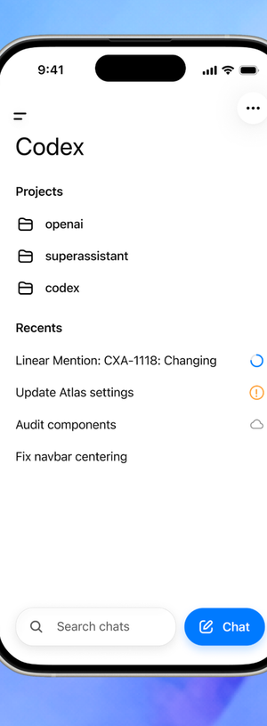
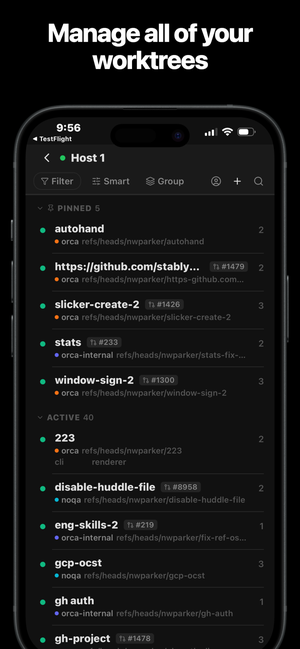
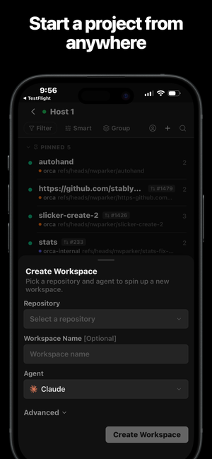
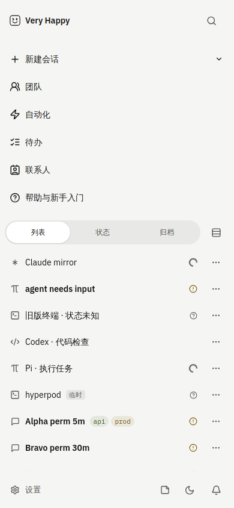
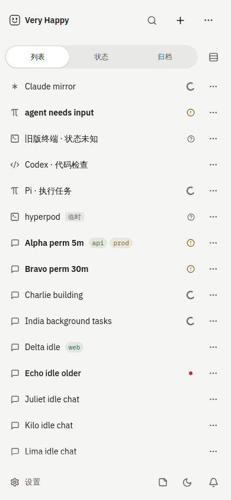
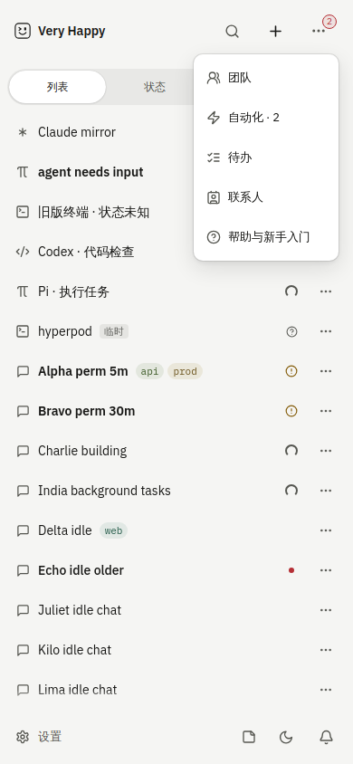
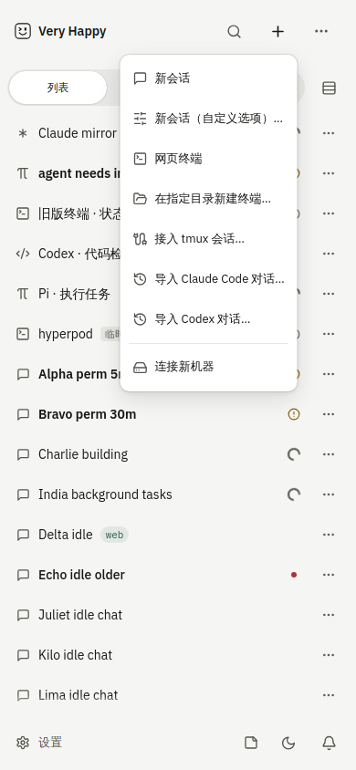
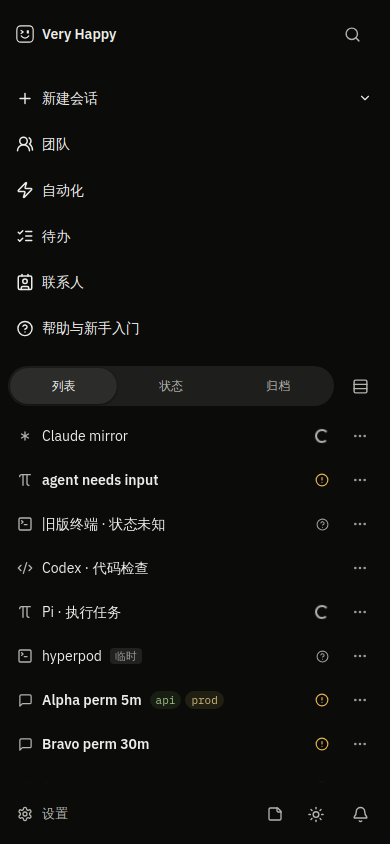
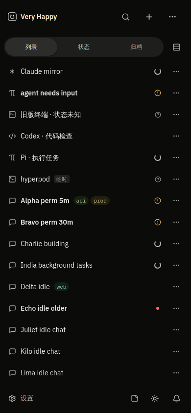
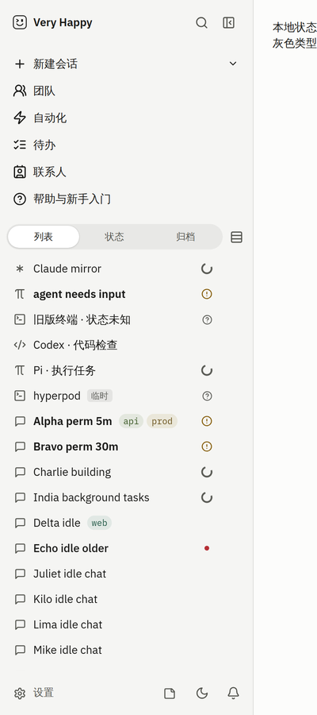

# 移动端侧边栏：会话列表占主要空间

> 状态：Final（随实现同 PR）
> 日期：2026-10-21 ｜ 关联 backlog：B-641 ｜ 出处：Owner 反馈「移动端侧边栏顶部入口太多，会话列表能滚动的区域很小」

## 背景

手机（单栏）首页就是侧边栏。列表上方依次堆着品牌行、新建会话、团队、自动化、待办、联系人、帮助（触屏每行 44px），
再加视图切换行，会话列表只剩不到一半屏幕。

## 目标

- iPhone 390×844（`pointer: coarse`）下，列表成为屏幕主体，首屏可见会话行数明显增加。
- 次要入口收起后仍然一步打开、逐个可达；需要用户处理的计数不因收起而消失。
- 新建会话仍在首屏一步可达（与改前同一菜单、同一步数）。
- 桌面两栏布局不变。

## 非目标

- 不改桌面侧栏、列表行密度（触屏 44px 行高按 design-language 保留）、视图切换/排序/分组语义。
- 不新增底部导航栏或浮动按钮，不改路由、不改 ⌘K。

## 参考（2026-10-21 采集）

| Codex（ChatGPT iOS 内 Codex 首页） | Orca iOS worktree 列表 | Orca iOS 新建 sheet |
|---|---|---|
|  |  |  |

来源：Codex 图裁自 testingcatalog.com「OpenAI brings Codex to ChatGPT mobile app for iOS and Android」配图（2026-05）；
Orca 两张为 App Store「Orca」（id6766130217）商店截图。缩小后仅作竞品对照。

观察：

- **Codex / ChatGPT**：列表上方只有一行圆形图标（≡ 抽屉、⋯ 更多）加标题；搜索与「✎ Chat」放在底部浮层，不占列表上方；
  ChatGPT Android 抽屉把 Library/Projects/Apps 之外的低频入口收进「More」，设置/账户走头像。
- **Orca**：列表上方 2 行（返回+主机；Filter/Smart/Group 文字按钮 + 账户/＋/🔍 三个图标），首屏约 11 行；
  ＋ 弹 bottom sheet 新建；设置等全局入口放在上一层 Hub 页，不在列表页。
- 共同点：列表上方 ≤ 2–3 行；新建、搜索做成图标或浮动按钮，不占整行；低频入口收进「更多」/头像/上层页。

## 现状事实（代码已确认）

| 事实 | 位置 |
|---|---|
| 手机根路由 AppShell 为 `list` 模式，侧栏全屏 | `src/screens/AppLayout.tsx`（`mode`）、`src/screens/AppShell.tsx` |
| 侧栏顶部：品牌 + 搜索；其下 `nav.sb-products` 6 个按钮（新建会话▾、团队、自动化、待办、联系人、帮助） | `src/screens/sessions/Sidebar.tsx` header / nav |
| 触屏下 nav 按钮与会话行均 `min-height: 44px` | `sidebar.css` `@media (pointer:coarse)` |
| 两栏/单栏由同一个 `useIsDesktop()`（`DESKTOP_SHELL_MQ`）决定 | `src/app/useMediaQuery.ts` |

**改前量化**（`/dev/sidebar` 真实 Sidebar + 示例数据，390×844 coarse，Playwright）：

| 区块 | 高度 |
|---|---|
| 品牌行 `.sb-header` | 68px |
| Workspace 导航 `.sb-products` | **290px** |
| 视图切换行 `.sb-list-controls` | 56px |
| 列表 `.sb-list`（可滚区域） | **370px，占视口 43.8%** |
| 底部设置行 `.sb-footer` | 60px |

首屏完整可见会话行：**8 行**。

## 设计

候选与取舍：

1. **底部栏（tab bar）**：把团队/自动化/待办等做成底部 tab。否决——5 个以上入口需要再折叠一次；
   底部已有设置/笔记/主题/通知行，再叠一层等于把 290px 从上面挪到下面；参考的两家都没有在列表页用 tab bar。
2. **浮动新建按钮（Codex 式 FAB）**：否决——会盖住最后一行与其 ⋯ 菜单；底部设置行已占据底边，叠加需要另调安全区；
   且新建在我们这里是多类型菜单（对话/终端/tmux/导入/连接机器），FAB 仍要弹菜单，不比顶部图标省步。
3. **顶部图标 + 「更多」菜单（采用）**：与 Orca 列表页工具栏同构（＋ / 🔍 图标在列表上方同一行），
   低频入口按 ChatGPT「More」收进 ⋯ 菜单。只改手机，不新增层级，不挤压列表。

落地（仅 `!isDesktop`，即手机单栏；桌面分支渲染逻辑不变）：

- 品牌行右侧：🔍 搜索（原有）、**＋ 新建**（同一个 `createItems` 菜单，首项「新会话」）、**⋯ 更多**。
- ⋯ 菜单：团队 / 自动化 / 待办 / 联系人 / 帮助，沿用原有可见性门（团队入口开关、自动化 404 隐藏）。
  需要处理的计数（自动化待决策、联系人请求）合计显示在 ⋯ 角标（danger 小胶囊，与 `.sb-nav-attn` 同语义），
  菜单项文案带 `· N`。菜单项触屏最小 44px（`.sb-touch-menu`）。
- `nav.sb-products` 只在桌面渲染。入口清单抽成纯函数 `sidebarNavEntries()`，桌面 nav 与手机 ⋯ 共用，保证两端入口不漂移。
- 视图切换行、列表、底部行不动。

## 兼容矩阵与发布顺序

纯 Web 视觉改动，无协议/存储变化；随正常 server/Web 镜像发布即可，回滚即回滚镜像。

## 风险

1. 新建从「整行按钮」变为图标：可发现性下降。缓解：图标在首屏右上、aria-label/title「新建会话」，与 Orca/Codex 位置一致；步数不变（1 次点击打开同一菜单）。
2. 团队/自动化等需要两次点击（⋯ → 项）。接受：均为低频入口；待处理计数上浮到 ⋯ 角标，不会被埋。
3. 平板/展开的折叠屏若落在单栏同样生效——与 AppShell 单/双栏判定一致，属预期。

## 验收标准

- [x] 390×844 coarse：首屏会话行 8 → **15**；列表高度 370 → **660px**（43.8% → **78.2%**）；无横向滚动。320×640 下首屏 10 行、无横向滚动。
- [x] 新建：首屏右上 ＋（44×44）一步打开创建菜单，8 项与桌面一致（新会话 … 连接新机器）。
- [x] ⋯ 逐项点击导航：团队→`/teams`、自动化→`/automations`、待办→`/todos`、联系人→`/people`、帮助→`/help`；菜单项 44px。
- [x] 自动化 2 条待决策时 ⋯ 角标显示 2，菜单项「自动化 · 2」。
- [x] 搜索 🔍 仍打开 ⌘K 面板。
- [x] 桌面 1440×900：侧栏各区块高度与首屏行数（16 行）前后一致；截图像素差仅为运行中 spinner 的旋转相位。

截图：

| 改前 iPhone | 改后 iPhone | 改后 ⋯ 菜单（含待决策角标） | 改后 ＋ 菜单 |
|---|---|---|---|
|  |  |  |  |

| 改前暗色 | 改后暗色 | 桌面改前 | 桌面改后 |
|---|---|---|---|
|  |  |  |  |

（示例数据，来自 `/dev/sidebar` harness。）

## 留真机验证项

- iOS Safari / PWA 真机：右上三个 44px 图标在刘海安全区下的点按手感；⋯ 角标在动态岛机型上不被裁切（浏览器模拟无真实安全区）。
