# 侧栏顶部：按钮更少，新建会话与新建项目一眼可见

> 状态：Final（随实现同 PR）
> 日期：2026-10-21 ｜ 关联 backlog：B-676、B-713（§B-713 修订，覆盖下文冲突部分） ｜ 出处：Owner 10-21「侧栏顶部按钮太多，新建项目入口也不明显」；Lead 授权按证据定方案
> 前置：B-641（手机侧栏，[spec](2026-10-mobile-sidebar.md)）、B-647/B-648（项目分组与项目页，[spec](2026-10-projects.md) §6）、B-650（会话搜索）、B-653（菜单项 44px）。本改动在它们的基础上做，不回退其效果。

## 目标

- 桌面侧栏顶部常驻按钮明显变少，列表拿回高度。
- 「新建会话」「新建项目」都一步可达、一眼能看到（带文字，不藏在菜单里）。
- 低频入口收进菜单；需要用户处理的计数不因收起而消失。
- 手机保持 B-641 的会话行数优势（顶部不加行）。
- 遵守 design-language（1-Border Rule、只用 token、触屏 44px）和改动行 design lint。

## 非目标

- 不改列表工具行（列表 / 状态 / 归档、分组菜单）、底部行（设置 / 笔记 / 主题 / 通知）和收起后的桌面窄栏。
- 不改路由、⌘K、⌘⇧F、⌘N 的语义。
- 不新增可自定义导航（比如 Orca 的「Hide from sidebar」）。见取舍 3。

## 现状盘点（改前，main @ 1267e21e，代码与 `/dev/sidebar` 实测）

### 桌面（两栏，1440×900）

| # | 位置 | 控件 | 去向 | 使用频率判断（无埋点，依据见右） |
|---|---|---|---|---|
| 1 | 品牌行 | 品牌（点击打开帮助） | 原位 | 低频；整页只放一组品牌（design-language §品牌） |
| 2 | 品牌行 | 🔍 会话搜索（⌘⇧F；⌘K 另有） | 原位 | 高频（B-650 的主入口） |
| 3 | 品牌行 | ⊟ 收起侧栏 | 原位 | 中频 |
| 4 | 导航列 | ＋ 新建会话 ▾（整行是菜单：新项目、新会话、高级、终端、指定目录终端、接入 tmux、导入 Claude、导入 Codex、连接机器） | 拆成「主区直接开对话 + ▾ 完整菜单」 | **最高频**。但改前要两次点击：先开菜单，菜单第一项还是「新项目」 |
| 5 | 导航列 | 团队 | ⋯ 菜单 | 中频。团队本身已作为行嵌在列表里（B-480/B-647），这个入口主要用来新建团队、看总览 |
| 6 | 导航列 | 自动化（危险色计数徽标） | ⋯ 菜单（计数上浮到 ⋯ 角标） | 中低频。需要决策时靠徽标提醒 |
| 7 | 导航列 | 待办 | ⋯ 菜单 | 中低频 |
| 8 | 导航列 | 联系人（好友请求计数） | ⋯ 菜单 | 低频（会话共享才用） |
| 9 | 导航列 | 帮助与入门 | ⋯ 菜单（另由品牌直达） | 低频，且与 #1 重复 |
| — | 菜单内 | 新建项目 | 独立一行「新建项目」 | 项目刚上线（B-644~649），Owner 要求鼓励使用，但入口藏在新建菜单里 |

实测：常驻可点控件 **9 个**（含品牌）；列表上方共 **7 行**；列表从 y=322px 开始，高 523px（视口的 58.1%），首屏完整可见 **12 行**。

### 手机（单栏，390×844，`pointer: coarse`）

B-641 后品牌行是：品牌 · 🔍 · ＋（创建菜单）· ⋯（团队/自动化/待办/联系人/帮助）。常驻 **4 个**；列表 660px（78.2%），首屏完整可见 11 行（harness 数据比 B-641 记录时多了分组头）。

## 竞品对照（2026-10-21 采集）

参考原图有版权风险，不进公开仓库，原图在 Owner 本机 `~/code/github/skills/tmp/vh-team-B-676/refs/`（`codex/`、`claude/`、`orca/`）。Orca 源码检出在同目录 `orca-src/`。

| | Codex 桌面（ChatGPT desktop 的 Codex 视图，2026-10） | Claude Code 桌面 / claude.ai（2026-10 current layout） | Orca（stablyai/orca @0a9980b1，源码核验） |
|---|---|---|---|
| 顶栏 | 收起侧栏、前进后退；标题行「Codex ⌄」+ 🔍 搜索 + 🔔 动态 | 收起侧栏、前进后退、Claude/Code 切换；下一行是全宽搜索框 | 标题栏：应用名、收起、前进后退 |
| 新建会话 | 第一行「New chat」，**1 次点击**（⌘N）；行尾 hover 出 Quick chat | 第一行「+ New」，**1 次点击**（⌘N） | 列表头最右的 `+` 图标，1 次点击打开新建弹窗 |
| 新建项目 | Projects 分组头 hover 出 `+`，或在新对话页的项目 chip 里选 New project（2~3 次） | 侧栏 Projects → New project（**2 次**） | 列表头的 `FolderPlus`「Add project」图标，**1 次** |
| 次级导航 | 3 个导航行（Pull requests / Scheduled / Plugins），其余收进「… Explore」 | 3~5 个导航行（Projects / Scheduled / Customize…），其余收进「··· More」 | 默认 4 个导航行（Search / Tasks / Automations / Mobile），每行可以右键隐藏 |
| 设置 / 帮助 | 侧栏底部（头像菜单、`?`） | 左下账户菜单 | 底栏（齿轮、帮助下拉） |
| 手机 | 顶栏 `≡` · 标题 · 🔍；底部常驻输入框，直接新建 | App 内 Code 标签 | 右下 FAB 新建；header 只放图标 |

观察：

1. **新建会话永远是第一行、带文字、一次点击。** 三家都没有让用户先开菜单再选「新会话」。我们改前要两次点击，而且菜单第一项是「新项目」，这是本次最直接的问题。
2. **新建项目紧挨新建会话，或者挂在项目列表头上。** Orca 用 FolderPlus 图标 1 次点击；Claude 要 2 次。我们把它做成带文字的独立一行，比两家都更醒目，符合 Owner「鼓励大家用项目」。
3. **次级导航最多常驻 3~4 行，其余进「More」，设置/帮助放底部。** 我们改前有 5 行常驻（团队/自动化/待办/联系人/帮助），加上新建一共 6 行。
4. **手机端都不在列表上方堆行。** 与 B-641 的结论一致。

## 方案取舍

| 方案 | 桌面常驻控件 | 列表上方行数 | 新建会话 | 新建项目 | 结论 |
|---|---|---|---|---|---|
| A. 维持导航列，只加「新建项目」行 | 10 | 8 | 2 次 | 1 次 | 否决：按钮更多，与目标相反 |
| B. 照 Codex：新建 + 3 个导航行（团队/自动化/待办）+「⋯ 更多」行 | 10 | 6 | 1 次 | 1 次（再加一行）或 2 次 | 否决：常驻控件不减反增，「顶部按钮明显变少」不成立 |
| C. Orca 式：新建会话、新建项目做成列表工具行里的图标 | 7 | 2 | 1 次 | 1 次 | 否决：两者都只剩图标，「一眼看到」靠认图标；工具行还要挤进分段控件 |
| **D. 品牌行 🔍 · ⋯ · ⊟；下面两行带文字：「＋ 新建会话 \| ▾」「新建项目」；次级入口全部进 ⋯（采用）** | **7** | **3** | **1 次**（▾ 2 次进其他类型） | **1 次** | 采用 |

D 的理由：

- **两个最重要的动作都是带文字的整行**，和 Codex/Claude 的第一行同构。新建会话拆成主区和 ▾：主区复用 `createChatOrConfigure`，也就是原菜单的「新会话」（按记住的机器和目录直接开，判断不了时回落到完整对话框）；▾ 保留全部 9 种创建方式，菜单按整行宽度左对齐（design-language B-435 条款）。
- **次级入口进 ⋯，与手机共用同一份 `sidebarNavEntries()`**：两端菜单内容、顺序、可见性门、计数完全一致，只多了桌面的 ⊟。⋯ 角标是待处理总数（自动化待决策 + 好友请求），菜单项带「· N」，所以收起后不会漏掉需要处理的事（B-641 机制原样复用）。
- **帮助仍一步可达**：品牌行本来就直达帮助，⋯ 里再放一个。团队和待办变成两次点击（⋯ → 项），见取舍 2。
- 列表工具行和底部行不动，B-647/B-675 的分组菜单、B-650 的搜索都不受影响。

### 取舍 1：手机为什么不加「新建项目」图标

手机品牌行已经是 品牌 · 🔍 · ＋ · ⋯。320px 宽时，16px 边距加 3 个 44px 图标已经占满（288px 可用，品牌约 140px + 132px）。再加第 4 个图标会挤压品牌或换行，加一行又违背 B-641。所以手机上新建项目放在 ＋ 菜单第二项（第一项是新会话），步数与改前的新建会话一致：一次点击打开菜单，第二次点击执行。

### 取舍 2：团队 / 自动化 / 待办从常驻变成两次点击

- 团队：已有团队都作为行嵌在列表里（点团队名进团队页）。这个入口的剩余用途是新建团队和看总览，频率低于打开某个团队。
- 自动化：真正需要注意的时刻（有待决策的运行）由 ⋯ 角标和菜单项计数提示，与 B-641 手机端一致。
- 待办：⌘K 命令面板也能打开。
- 代价：习惯点导航列的人要多点一次。可逆：将来要固定某项，只需给 `sidebarTopModel` 加一项。

### 取舍 3：不做「用户自定义固定哪些入口」

Orca 允许逐行隐藏，但这需要新的设置字段、迁移和设置页 UI。本次目标是减少按钮，先不扩大配置面。观察一段时间后再决定。

## 实现

- `sidebarNavEntries.ts`：新增纯函数 `sidebarTopModel({ isDesktop, projectsReady })`。桌面返回 `header: [search, more, collapse]`、`actions: [new-session, new-project?]`；手机返回 `header: [search, create-menu, more]`、`actions: []`。另有 `orderCreateMenu()`，让创建菜单的顺序固定为新会话、新项目、其余。
- `Sidebar.tsx`：品牌行和动作行按模型渲染。删掉桌面导航列 `nav.sb-products`。新建会话拆成 `.sb-new-main`（直接开对话）和 `.sb-new-more`（▾，完整创建菜单，`contentMinWidth` 等于整行宽度）。「新建项目」行调用现有的 `createNamedProject`，只在 projects API 返回 ready 后出现。
- `ui/Menu.tsx`：`ActionDropdownMenu` 新增可选 `contentMinWidth`。
- `sidebar.css`：`.sb-actions` / `.sb-new-split`，行高和留白沿用原导航列（桌面 32px，coarse 44px，▾ 在 coarse 下宽 44px）。没有新增描边，只用 token。
- 落地页的工作台示意（`ProductWorkspacePreview`）同步成新顶部结构。
- 文案：`sidebar.newMenu`（「更多新建方式」/ More ways to create）；中文 `sidebar.newProject` 改为「新建项目」，与「新建会话」对齐。

## 兼容矩阵与发布顺序

纯 Web 视觉与交互改动，无协议、存储或设置变化；随正常 server/Web 镜像发布，回滚即回滚镜像。

## 验收（`/dev/sidebar` 真实 Sidebar + 示例数据，Playwright + Chromium）

| 指标 | 桌面 1440×900 改前 | 桌面改后 | 手机 390×844 coarse 改前 | 手机改后 |
|---|---|---|---|---|
| 顶部常驻可点控件（含品牌） | **9** | **7** | 4 | 4 |
| 列表上方行数（品牌行 + 导航/动作行） | 7 | **3** | 1 | 1 |
| 列表起点 / 高度 | 322px / 523px（58.1%） | 178px / **667px（74.1%）** | 124px / 660px（78.2%） | 不变 |
| 首屏完整可见行 | 12 | **17** | 11 | 11 |
| 新建会话 | 2 次点击 | **1 次** | 2 次（＋ → 新会话） | 2 次（不变） |
| 新建项目 | 2 次（藏在菜单） | **1 次，带文字** | 2 次 | 2 次（＋ 菜单第二项） |
| 横向滚动 | 0 | 0 | 0 | 0 |

逐个入口验证（两种尺寸各跑一遍，结果见 PR）：

- [x] ⋯ 菜单 5 项依次打开 `/teams`、`/automations`、`/todos`、`/people`、`/help`。桌面菜单行 35px，coarse 下 44px。
- [x] 自动化有 2 条待决策时，⋯ 角标显示 2，aria-label 为「More · 2」，菜单项为「Automations · 2」。
- [x] 新建会话主区点一下进入新对话流程（harness 无法直接 spawn，回落到配置对话框，与改前菜单「新会话」行为相同）。
- [x] ▾ 打开完整创建菜单，9 项，顺序：新会话、新项目、高级…、终端、指定目录终端、接入 tmux、导入 Claude、导入 Codex、连接机器。菜单宽 303px 等于整行宽 303px，左边缘对齐。
- [x] 新建项目打开命名对话框。
- [x] 手机 ＋ 菜单前两项为新会话、新项目。
- [x] 🔍 仍打开会话搜索；⊟ 仍收起侧栏。
- [x] 明暗两套主题截图；design lint 0。

截图（示例数据）：

| 桌面改前 | 桌面改后 | 桌面 ⋯ 菜单（待决策 2） | 桌面 ▾ 创建菜单 |
|---|---|---|---|
| 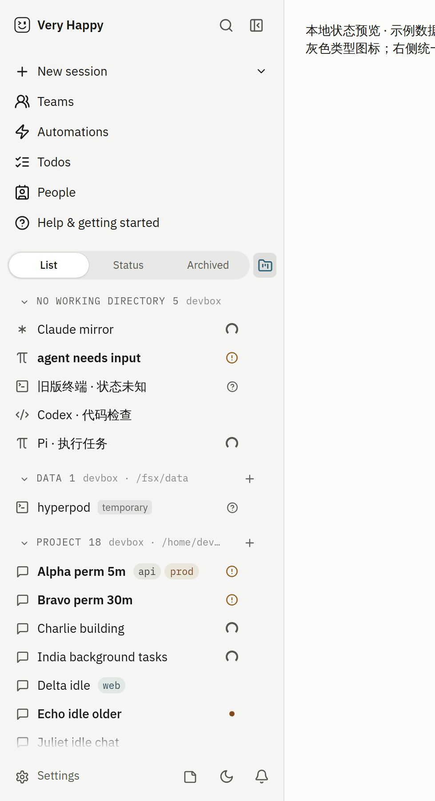 | 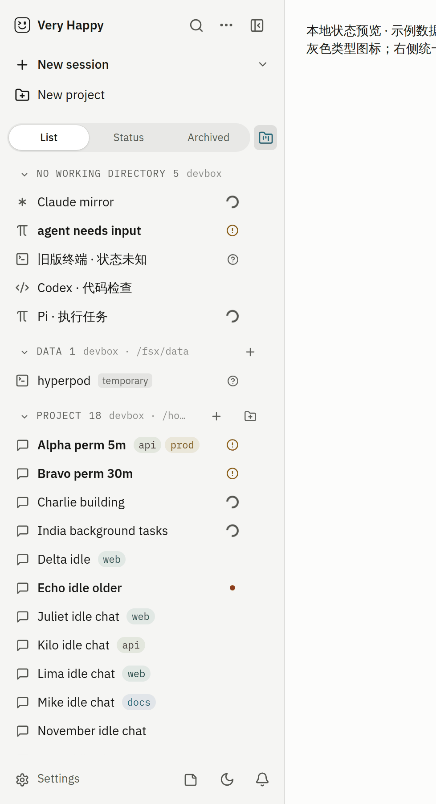 | 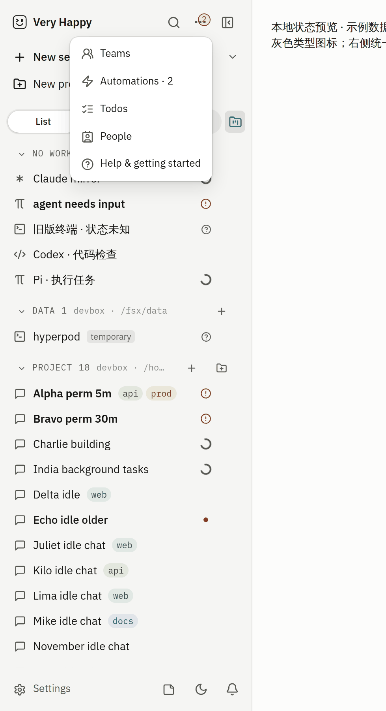 | 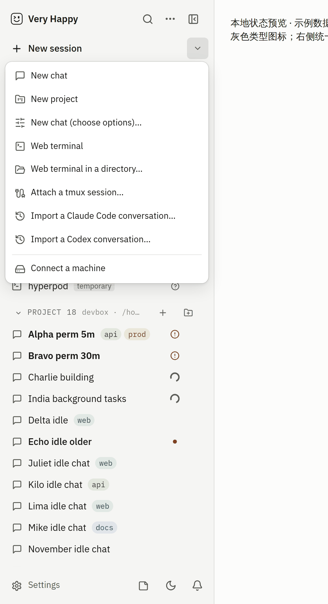 |

| 手机改前 | 手机改后（不变） | 手机 ＋ 菜单 | 桌面暗色 |
|---|---|---|---|
| 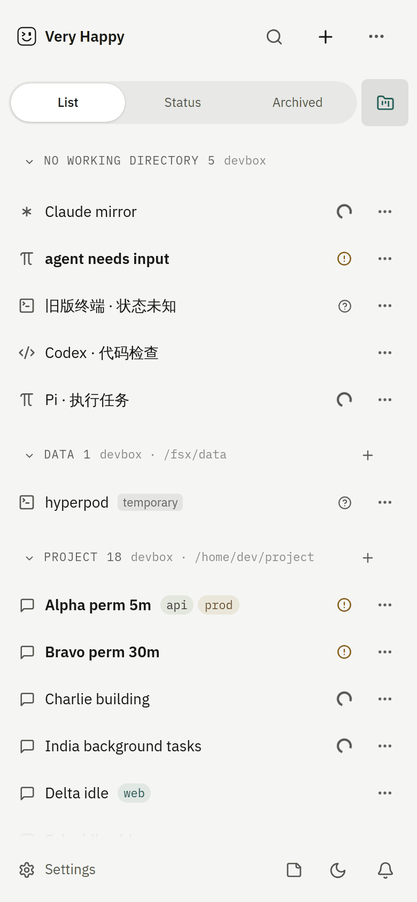 | 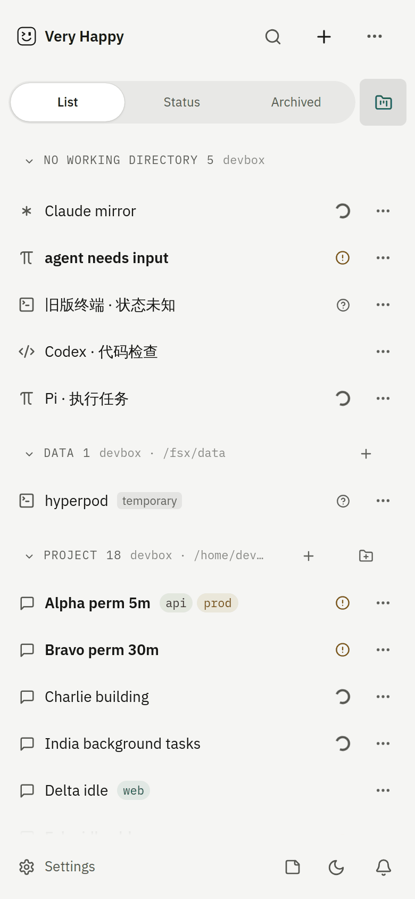 | 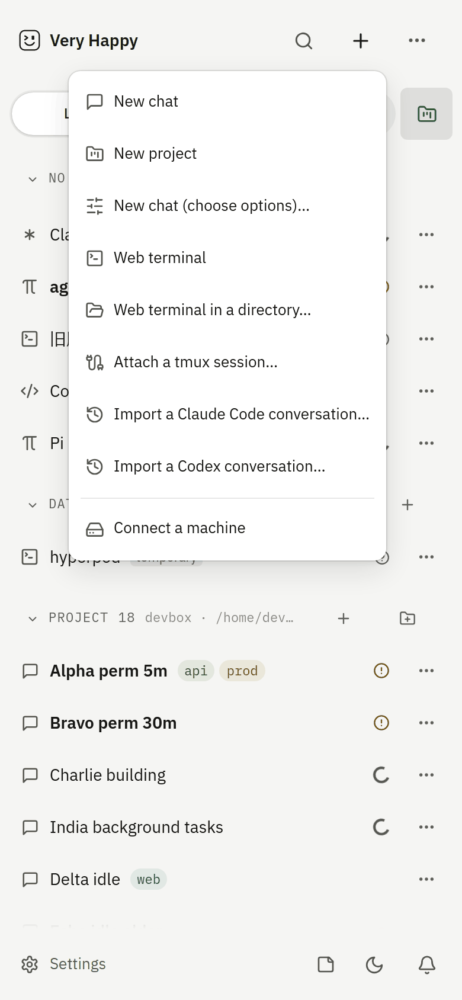 | 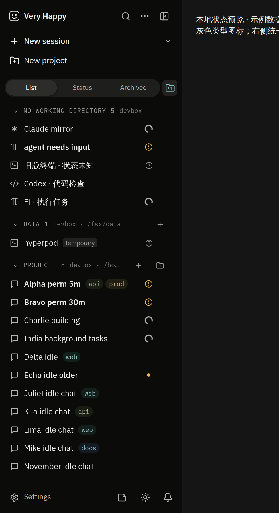 |

## 风险

1. 习惯点导航列「团队」「待办」的人需要重新找入口。缓解：⋯ 与手机同位置同内容；团队行仍在列表里；⌘K 可达；本条写进更新说明。
2. 新建会话主区「直接开」与改前「先开菜单」行为不同，可能误开对话。缓解：主区与改前菜单里的「新会话」完全同一路径（判断不了时回落到对话框）；按钮带 ▾ 区分，其他类型仍在 ▾。
3. 触屏笔记本（桌面布局 + coarse）：动作行和 ▾ 的命中区按 coarse 规则放大到 44px。

## B-713 修订：三个主入口、能力入口按高度自适应、帮助进底栏

> B-896 起本节的「三行新建 + 能力行按高度折叠」被下文「B-896 修订」取代，保留作历史记录。

> Owner 10-21：「侧边栏应该是新建对话、新建项目、新建团队」「帮助在侧边栏最下面加个入口」；第二次反馈：「入口被隐藏了，大屏幕就都默认展示几个入口，小尺寸再隐藏；不要用右上角的 ⋯，改成新建项目下有一个更多能力 dropdown」「logo 在移动端默认就是 hover 态」。本节覆盖上文方案 D 中关于 ⋯ 菜单与手机 ＋/⋯ 的部分。

### 结构

| | 桌面（两栏） | 手机（单栏，coarse） |
|---|---|---|
| 品牌行 | 品牌 · 🔍 · 收起（**去掉 ⋯**） | 品牌 · 🔍 · ＋（＋ 仍一步打开 B-641 创建菜单） |
| 主操作 | 「＋ 新建会话 \| ▾」「新建项目」「新建团队」三行，图标 + 文字 | 一行 44px chip：「项目 · 团队 · 更多 ▾」（新建项目 / 新建团队 / 能力入口菜单） |
| 能力入口 | 团队 > 自动化 > 待办 > 联系人，放得下就逐行展示；放不下的进「更多能力 ▾」（`ActionDropdownMenu`），全部放得下时这一行不出现 | 全部在「更多 ▾」 |
| 计数 | 行内 / 菜单项「· N」；「更多能力」「更多」显示被折叠项的合计 | 同左 |
| 底栏 | 设置 · **帮助** · 笔记 · 主题 · 通知；侧栏 <300px（默认宽 260）时设置只留齿轮（aria-label 保留），帮助保留文字 | 同左（抽屉全宽，两者都有文字） |

- 文案沿用「会话」，不改「对话」。新增 key：`sidebar.newTeam`、`sidebar.help`、`sidebar.capabilities`、`sidebar.moreCapabilities`、`sidebar.chipProject`、`sidebar.chipTeam`（中英）。
- 「新建团队」只在 Teams 入口可见（`happyBotEntryVisible`）时出现；「新建项目」只在 projects API ready 后出现（与 B-676 相同）。

### 新建团队直达创建流程

点击导航到 `/teams?new=1`。`TeamsScreen` 已有 `new=1 → setCreating(true)`，直接弹出 `TeamStartForm` 创建弹窗。修了一个缺陷：关弹窗只改了本地 state、URL 仍是 `?new=1`，再点侧栏按钮 URL 不变、effect 不触发、弹窗打不开；现在关闭时删掉 `new` 参数。没有在线且支持团队的机器时，弹窗内 `TeamStartForm` 原有提示「需要在线且支持团队能力的机器…」+「机器设置 →」链接，不新增前置判断。

### 自适应规则（`fitCapabilityRows`，纯函数）

- 会话列表首屏至少完整显示 `MIN_LIST_ROWS = 8` 行。「8 行需要的高度」按实测：第 8 个 `.sb-row` 的底边（内容坐标，含分组头和内边距）；不足 8 行时按已有平均行距外推。
- 列表高度 + 能力区高度在行于两者间移动时不变，记 S；spare = S − 8 行所需高度。全部 n 行放得下（n × 行距 ≤ spare）就全展示；否则展示 k = ⌊spare / 行距⌋ − 1 行（多出的一行给「更多能力」），最少 0。
- `ResizeObserver`（侧栏根与列表）+ `MutationObserver`（列表晚挂载、分组折叠）触发，按帧合并；窗口缩放实时生效，不只首屏判断一次。
- Lead 给的参考值（≥900 全展示、中屏前两个）与「保 8 行」冲突时以 8 行为准；示例数据下实测见下表。

### 触屏 sticky hover

`sidebar.css` 里所有 `:hover` 规则都包进 `@media (hover: hover) and (pointer: fine)`（原来带 `:focus-visible` 的组合选择器拆开，焦点样式不受影响）。回归测试 `sidebarHover.test.ts` 解析 CSS，任何未受 hover 媒体查询保护的 `:hover` 都会失败。实测 390 coarse 下 hover 品牌后背景为 `rgba(0,0,0,0)`，桌面仍是 `--fill-hover`。全站其他组件的同类问题由 UI 走查统一列出，不在本条范围。

### 键盘

所有新入口都是原生 `<button>`；桌面 Tab 顺序：品牌（帮助）→ 搜索 → 收起 → 新建会话 → ▾ → 新建项目 → 新建团队 → 团队 → 自动化 → 待办 → 联系人，每一项 `box-shadow` 为 `--focus-ring`（`.sb-actions .sb-nav-btn:focus-visible` 原来把环去掉了，现在保留）。

### 实测（`/dev/sidebar` 示例数据，Chromium，B-676 版本 → B-713）

| 视口 | 能力行 | 列表起点 / 高 | 首屏完整行数 |
|---|---|---|---|
| 1440×1000 | 4 行全展示 | 178/767 → 352/593 | 19 → 14 |
| 1440×900 | 4 行全展示 | 178/667 → 352/493 | 16 → 11 |
| 1280×720 | 团队 + 更多能力 | 178/487 → 284/381 | 11 → **8** |
| 1280×600 | 仅更多能力 | 178/367 → 250/295 | 8 → 6（全部已折叠，3 个新建行是硬下限） |
| 390×844 coarse | chip 行 | 124/660 → 172/612 | 11 → **10**（−1，在允许范围） |
| 320×640 coarse | chip 行 | 124/456 → 172/408 | 6 → 6 |

横向滚动均为 0；手机「更多」菜单项高 44px（桌面 35px，B-653 只要求触屏）；缩放往返 1000→720→600→820→1000 每步重算正确。截图与原始数据在 Owner 本机 `~/code/github/skills/tmp/vh-team-B-713/`（`shots/`、`after.jsonl`），关键几张入库在 `docs/screenshots/b713-sidebar-entries/`。

### 实现

- `sidebarNavEntries.ts`：`sidebarNavEntries` 去掉 help；`sidebarTopModel({ isDesktop, projectsReady, teamsVisible })` 返回 `header / actions / chips`；新增 `NEW_TEAM_PATH`、`MIN_LIST_ROWS`、`fitCapabilityRows`、`splitCapabilities`。
- `SidebarTop.tsx`（新）：`SidebarActionRows`（含 `useCapabilityFit`）、`SidebarChipRow`、`SidebarFooter`、`capabilityMenuItems`；`Sidebar.tsx` 只负责传数据。
- `TeamsScreen.tsx`：`closeCreate` 删除 `new` 参数。
- 文档同步：design-language、站内文档（`publicContent*`）、`docs/automations.md`、落地页工作台示意。

### 兼容与发布

纯 Web；无协议、存储、设置字段变化，随 server/Web 镜像发布，回滚即回滚镜像。

### 用户可见变更

- 中：侧栏顶部改为「新建会话 / 新建项目 / 新建团队」三个入口，团队、自动化、待办、联系人在大屏直接显示、小窗口收进「更多能力」；帮助移到侧栏底部。
- EN: The sidebar now leads with New session, New project and New team; Teams, Automations, Todos and People show directly on tall screens and fold into More features on smaller ones; Help moved to the sidebar footer.

| 桌面 1440×900 亮 | 桌面 1440×900 暗 | 1280×720（折叠） | 手机 390×844 |
|---|---|---|---|
| 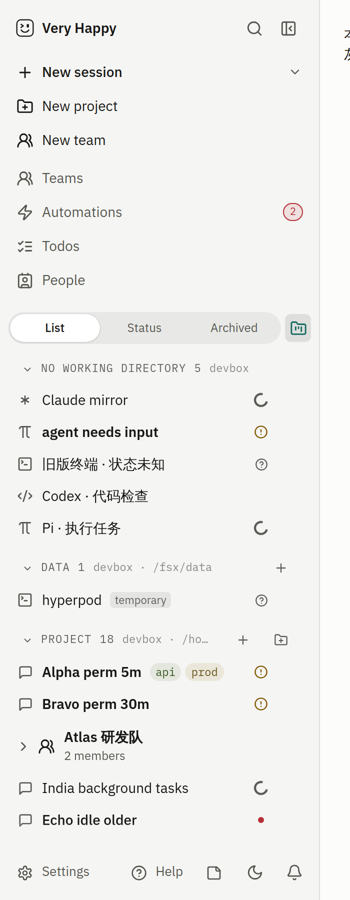 | 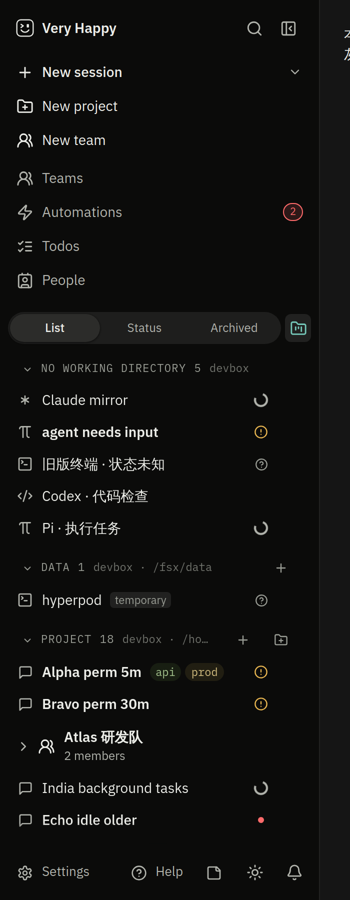 | 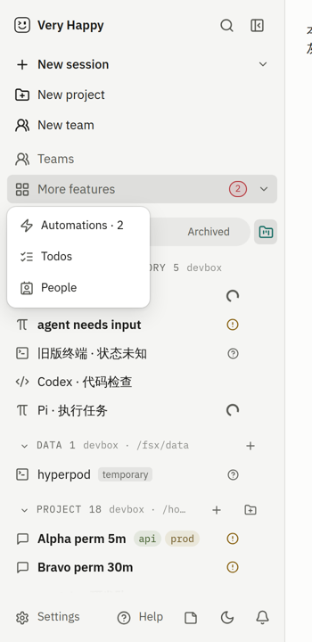 | 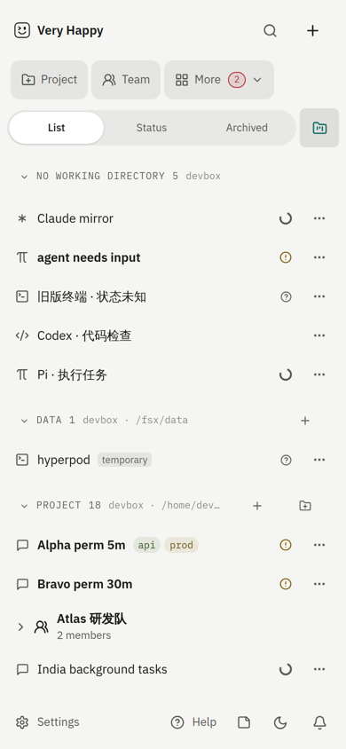 |

## B-896 修订：新建合一 + 入口图标条（方案 A1，Owner 11-06 选定）

> B-926 起本节的「入口图标条」被下文「B-926 修订」取代（新建合一、键盘、⌘K、触屏抽屉不变），保留作历史记录。

> 依据：B-892 三方案对比（A1 图标条 / A2 常用 2 + 更多 / B 底部带字栏），Owner 选 A1。原型分支 `prototype/B-892-sidebar-top` 只参考，从 main 重做，去掉原型开关。

### 结构（桌面与触屏抽屉）

| 位置 | 内容 |
|---|---|
| 品牌行 | 品牌 · 🔍 · 收起（不变） |
| 新建 | 「＋ 新建会话 \| ▾」一行。主区一键开会话；▾ 是完整创建菜单：新会话、新建项目、新建团队、自定义新会话、网页终端、在指定目录开终端、接入 tmux、导入 Claude Code / Codex、连接新机器 |
| 新用户行 | 账号没有项目时多一行「新建项目」，没有团队（且 Teams 入口可见）时多一行「新建团队」，各自建过一个后消失。数量未知（还没加载 / 读取失败）时不显示，老账号不会闪出这两行 |
| 入口条 | 一行等宽图标格：Issues · 运行中 · 项目 · 团队 · 自动化 · 联系人（账号没开 Issues 时：项目 · 团队 · 自动化 · 待办 · 联系人），点一下直达，角标保留（右上角小徽标，warn / danger 语义不变） |
| 底栏 | 不变 |

手机单栏不变（chip 行「Issues · 项目 · 团队 · 更多 ▾」）。

- **键盘**：入口条 `role=toolbar`，只占一个 Tab 位（roving tabindex：停在当前页那格，没有就第一格）；←/→ 循环，Home/End 到两端，Enter / Space 打开；当前页（含子路由，如 `/issues/VH-3`）`aria-current=page`，用 `--fill-selected`；焦点环 `--focus-ring`。纯函数 `stripFocusTarget`、`isEntryCurrent`。
- **tooltip**：按设计规范用原生 `title` + `aria-label`，内容是名字加计数（「自动化 · 2」）。
- **⌘K 补齐**（`screens/command/navigationActions.ts`）：Issues、运行中、项目、自动化、联系人、新建项目、新建团队都是动作项，中英文名字都在 haystack 里；可见条件与侧栏相同。只加动作项，不动匹配与排序（B-895 在改）。「新建项目」经 `sidebarEvents.requestNewProject()` 打开侧栏里的同一个对话框，没有挂载的侧栏时退到 `/projects`。
- **触屏抽屉**（竖屏 iPad 等，`appShellMode` 的 drawer 档）：渲染同一个桌面侧栏；格子 44×44，抽屉最小宽 280px（`DRAWER_MIN_WIDTH`，六格 × 44 + 两侧 8px），不受保存的桌面宽度影响。
- **去掉**：`fitCapabilityRows` / `settleCapabilityRows` / `useCapabilityFit` / 「更多能力 ▾」及其回归测试（B-713/B-828 的按高度折叠与防抖动），`e2e/sidebar-caps-flicker.mjs`。图标条高度固定，不再需要按高度折叠。

### 实测（生产构建 + 隔离 standalone server + 真实隔离 daemon，Chromium）

| 视口 | 列表起始 y | 首屏完整行数 | 入口格 | 横向溢出 | pageerror |
|---|---|---|---|---|---|
| 1440×900 亮 中文（有项目、团队、25 个会话） | **180**（B-713：352；生产实测 420） | 14 | 6 × 39×32 | 0 | 0 |
| 1280×800 亮 中文 | 180 | 11 | 6 × 39×32 | 0 | 0 |
| 1440×900 暗 英文 | 180 | 13 | 6 | 0 | 0 |
| 1440×900 新账号、没开 Issues | 248（多「新建项目」「新建团队」两行） | — | 5 × 47×32 | 0 | 0 |
| 820×1180 coarse（iPad 抽屉） | 232 | 14 | 6 × **44×44**，抽屉宽 280 | 0 | 0 |
| 390×844 coarse 暗 英文（手机） | 180（不变） | — | chip 行 | 0 | 0 |

- 「Claude · 每周」用量行在侧栏底部（`SidebarRateLimit`，底栏上方）。隔离 daemon 没有上报用量窗口，所以在同一位置插入同 class 的一行（高 32px）再量：1440×900 与 1280×800 的列表起始 y 都仍是 **180**，列表高度各少 32px（首屏约少 1 行：1440×900 约 13 行，1280×800 约 10 行）。
- 抽屉开合：点 rail 按钮打开（`is-open`），点入口格导航后自动关闭，再打开后 Esc 关闭，全部实测通过。
- 键盘：从 ▾ 按 Tab 进入入口条落在当前页（/automations → 自动化），→ → End → Home ← 循环正确，Tab 离开、Shift+Tab 回到上次那格，Enter 打开「运行中」后 `aria-current` 跟着移动，可 Tab 的格子始终只有 1 个。
- ⌘K：7 个词（Issues、运行中、项目、自动化、联系人、新建项目、新建团队）第一条结果都是对应动作；「新建项目」回车弹出新建项目对话框。

截图在 `docs/screenshots/b896-sidebar-issues/`，原始数据在 Owner 本机 `~/code/github/skills/tmp/vh-team-B-896/`（`shots*.json`、`flow.json`）。

| 1440×900 亮 | 新账号 · 没开 Issues | iPad 抽屉 | 手机 390 暗 |
|---|---|---|---|
| 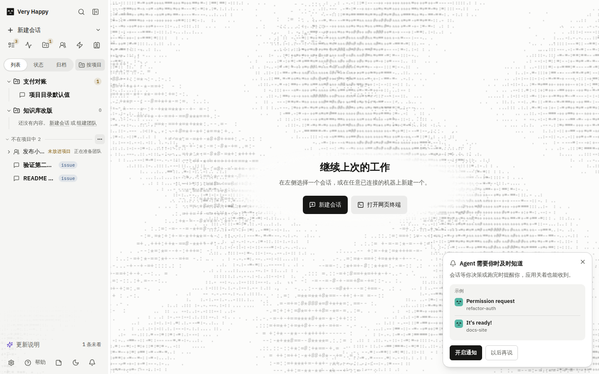 | 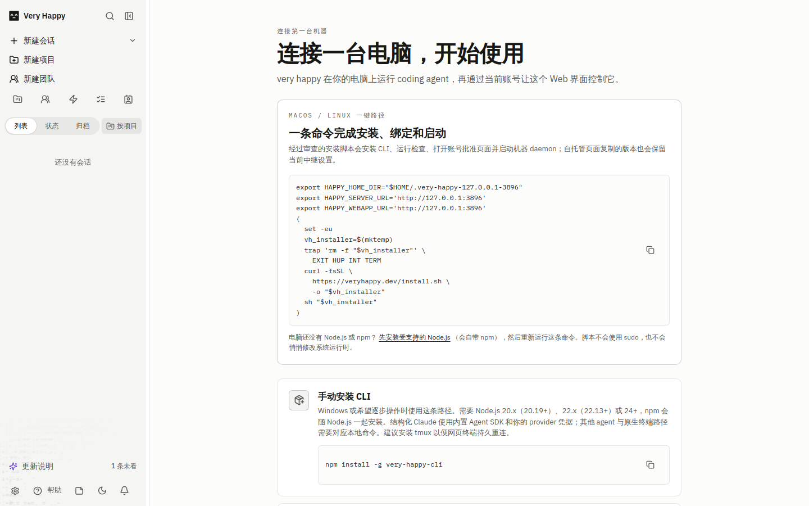 | 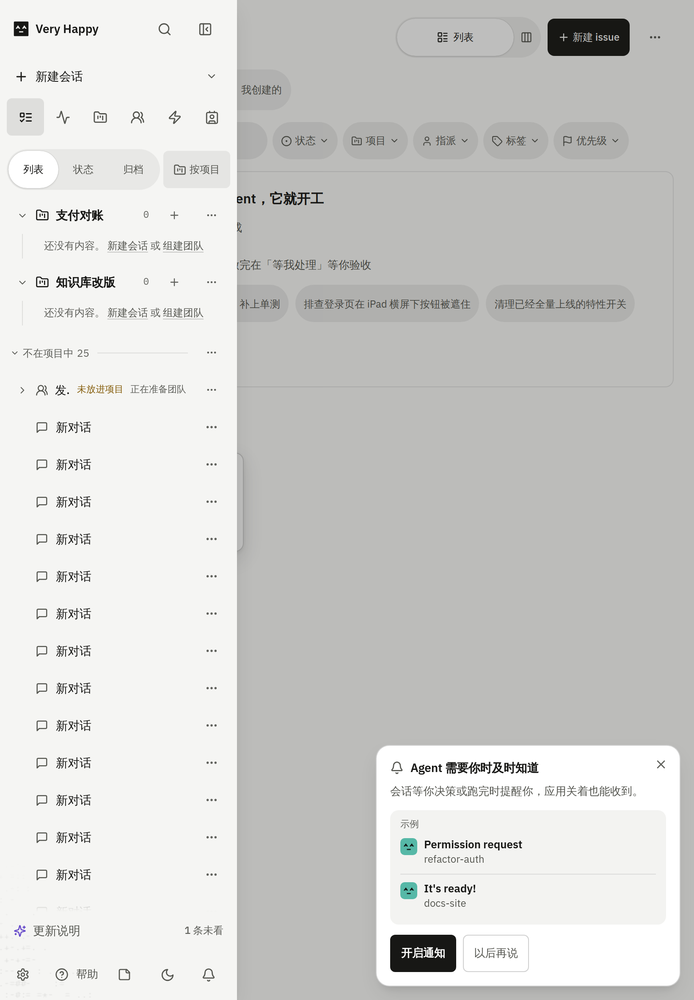 | 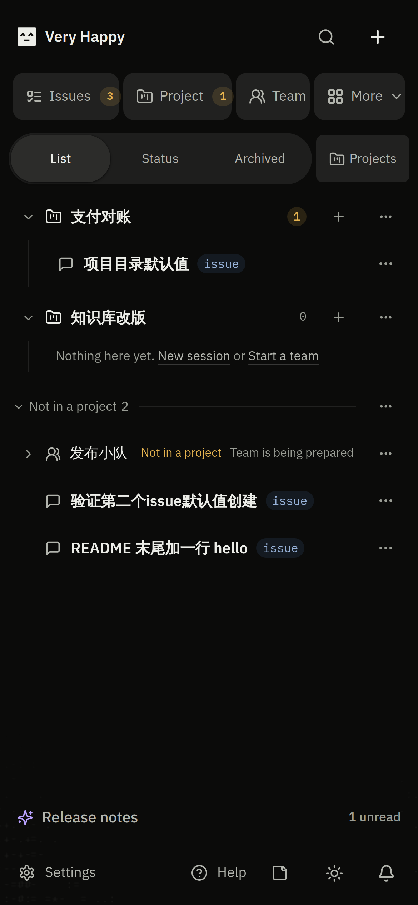 |

### 兼容与发布

纯 Web；无协议、存储（服务端）、设置字段变化。新增本机 MMKV 键 `issues-last-assignee:<accountId>`（Issues 页，见 issues spec §10 B-896），登出清除。随 server/Web 镜像发布，回滚即回滚镜像。

### 用户可见变更

- 中：侧栏顶部更紧凑：「新建会话 ▾」里能新建项目、团队、终端等一切；Issues、运行中、项目、团队、自动化、联系人收成一行图标，一下直达，⌘K 也能按名字搜到。Issues 页没有任务时有上手引导，按 C 新建、⌘↵ 创建；新建 issue 会记住上次的指派（机器、agent、目录、模型），条件不满足时回到「无」。
- EN: The sidebar top is more compact: New session ▾ now creates projects, teams, terminals and everything else, and Issues, Running, Projects, Teams, Automations and Contacts sit in one icon row, one click each and searchable in ⌘K. The Issues page explains itself when empty, C opens a new issue and ⌘↵ creates it, and a new issue starts from your last assignee (machine, agent, directory, model), falling back to None when that can't run.

## B-926 修订：入口带文字（Owner 11-11）

> Owner 11-11：「侧边栏设计我觉得不太好，现在都是一堆 logo，我都不知道是干啥的，就不能用文字吗？」参考 Codex desktop、Claude desktop：新建下面是一列带文字的入口，不常用的收进「更多」。

### 结构（桌面与触屏抽屉）

| 位置 | 内容 |
|---|---|
| 品牌行 / 主 agent / 新建 | 不变（主 agent 一行在品牌行下、新建会话上，开关与样式归 B-923） |
| 入口行 | 一行一个：图标 16px + 名字（13px、`--text-dim`，比新建行淡一档）+ 行尾计数，行高 28px（触屏 44px）。默认常驻前 4 个，最后一行「··· 更多 ▾」 |
| 更多 ▾ | 菜单列出没常驻的入口（带「· N」计数），分隔线后是「调整入口」；「更多」行尾显示被收起入口的计数合计 |
| 调整入口 | 入口区就地换成复选框列表（全部入口，勾选 = 常驻），头部「恢复默认」「完成」，Esc 退出；选择按设备存本机 `vh.sidebar.navPinned`（JSON key 列表，不同步，不进 settings） |
| 手机 | 不变：chip 行「Issues · 项目 · 团队 · 更多 ▾」本来就带文字 |
| 折叠 rail | 不变：只有展开按钮、通知、更新入口，均有 `title` + `aria-label` |

文案（2–4 字 / 英文短词）：Issues、运行看板 Agent board（原「运行中」，QA：单看不知道是什么；tooltip 补一句「所有正在跑的 agent」，页面标题与 ⌘K 同名，⌘K 仍能搜「运行中」）、项目 Projects、团队 Teams、自动化 Automations、待办 Todos、联系人 People、反馈 Feedback（入口里用短词，页面标题仍是「发送反馈」）、更多 More、调整入口 Edit entries、常驻入口 Pinned entries、恢复默认 Reset、完成 Done。

### 常驻与收起（`splitNavEntries`，纯函数）

默认常驻优先级前 4 个（`DEFAULT_PINNED_COUNT`），`foldedByDefault` 的反馈不参与：

| 账号 | 常驻 | 更多 | 理由 |
|---|---|---|---|
| 开了 Issues | Issues · 运行看板 · 项目 · 团队 | 自动化 · 联系人 · 反馈 | 前四个是每天进出的地方：Issues 是待办队列（带待处理计数）、运行中看全部 agent、项目树入口（带「需要你」计数）、团队；自动化和联系人更像配置页，打开频率低；自动化的待决定计数通过「更多」合计和通知中心仍然可见 |
| 没开 Issues | 项目 · 团队 · 自动化 · 待办 | 联系人 · 反馈 | 同一优先级顺延 |

- 用户的选择是 key 列表；按优先级排序展示，未知或当前不可见的 key 忽略，但保留（Issues 暂时不可用时取消/恢复不会丢掉它的常驻）。`togglePinnedEntry` 第一次改动时先把默认值落成显式列表。
- 「更多」行始终存在（即使全部常驻），因为「调整入口」在它的菜单里。

### 键盘与无障碍

- 入口区 `role=toolbar` + `aria-orientation=vertical`，只占一个 Tab 位（roving tabindex）：↑/↓（以及原来的 ←/→）在入口间移动，Home/End 到两端，Enter / Space 打开。「更多」是最后一站：焦点在「更多」上按 ↓（或 Enter / Space）会打开它的菜单（Radix 菜单按钮的行为），不会绕回第一行；要回第一行按 Home 或 ↑ 到顶后继续。
- 当前页 `aria-current=page` + `--fill-selected`；当前页被收进「更多」时 Tab 位落在「更多」（`.is-current` 文字加深）。
- 行的 `aria-label` 是「名字 · 计数」，`title` 是名字（窄侧栏截断时可读全名）；计数徽标 `aria-hidden`。
- 调整入口是原生复选框（`ui/Checkbox`），Space 切换；进入时焦点到「完成」，退出时回到「更多」。

### 实测（vite dev + `/dev/device/session/dev-board#issues` 假数据，Chromium）

| 视口 | 列表起始 y（前 → 后） | 列表高（前 → 后） | 比例 | 横向溢出 | pageerror |
|---|---|---|---|---|---|
| 1920×1080 亮/暗 · 中/英 | 216 → 328 | 773 → 661 | **86%** | 0 | 0 |
| 1440×900 亮 中文 | 216 → 328 | 593 → 481 | 81% | 0 | 0 |
| 1280×720 亮 中文 | 216 → 328 | 413 → 301 | 73% | 0 | 0 |
| 1920×1080 没开 Issues | 216 → 328 | 773 → 661 | 86% | 0 | 0 |
| 390×844 coarse（手机） | 228 → 228 | 512 → 512 | 100% | 0 | 0 |

同条件对比（两边都等底部更新入口那一行 36px 出现后再量）。入口区从 34px 变成 146px（4 行 + 更多，各 28px），列表起点下移 112px；验收线是 1080p ≥ 80%。小屏代价更大，可在「调整入口」里减少常驻行。

键盘实测：从新建 ▾ 按 Tab 落在 Issues，↓↓ End Home ↑ 依次为 运行中 / 项目 / 更多 / Issues / 更多，焦点环可见；Enter 打开「更多」菜单，Esc 关闭后焦点回到「更多」；菜单 End + Enter 进入调整，焦点在「完成」，Tab + Space 取消第一项后本机存 `["board","projects","teams"]`，Esc 退出后入口为 运行中 · 项目 · 团队 · 更多，刷新后保持。

### 兼容与发布

纯 Web；无协议、服务端存储、synced settings 变化。新增本机键 `vh.sidebar.navPinned`（缺失 / 坏值 = 默认）。随 server/Web 镜像发布，回滚即回滚镜像。

### 用户可见变更

- 中：侧栏入口带上了名字：「新建会话」下面那排图标改成一列带文字的入口（Issues、运行看板、项目、团队），其余的在「更多 ▾」，「更多 ▾ → 调整入口」可以选哪些常驻。
- EN: Sidebar entries have names: the icon row under New session is now a labelled list (Issues, Agent board, Projects, Teams), the rest are under More ▾, and More ▾ → Edit entries picks which rows stay.

## B-935 修订：入口随列表滚动（Owner 11-14，iPad 横屏）

问题：iPad 11 寸横屏（1210×834，coarse）下入口行各 44px，主 agent + 新建会话 + 4 行入口 + 更多 + 视图栏占到列表上方约 460px，再扣掉用量条和底栏，列表只剩约 270px（4 行），而且列表是唯一能滚的区域。

改法：侧栏头（品牌 · 搜索 · 收起）和底部（用量条 · 更新入口 · 底栏）不动；主 agent、新建会话、入口行、「列表 / 状态 / 归档」视图栏和会话列表放进同一个滚动容器 `.sb-scroll`。往下滑时入口行滚走，视图栏 `position: sticky` 留在顶部（底色 `--surface-sidebar`）。入口文字不变（B-926 口径）。手机单栏同样生效（芯片行随列表滚走）。

- 定位当前会话 / 派发后滚到新行 / 拖拽边缘自动滚动，都改为滚 `.sb-scroll`；「可见」按 `listScrollBand` 计算：从视图栏底边到滚动容器底边，被吸顶视图栏盖住的行不算可见。拖拽插入线仍相对 `.sb-list` 定位（列表本身不再滚动，`scrollTop` 恒为 0，公式不变）。
- 共享的 `vh-scroll-fade` 移到 `.sb-scroll`，只保留底部渐隐：顶部渐隐会把吸顶的视图栏也淡掉。
- 未做「矮屏 coarse 压缩入口行高」和「用量条改单行」：单滚动容器后列表可见高度已从 270px 到 554px；用量条本来就是单行（coarse 44px 触控高度）。

实测（`/dev/device/session/dev-board#sidebar-dense`，同一组假数据，列表滚到 400px 后量列表可见高度 / 完整可见行数）：

| 视口 | 修前 | 修后 |
| --- | --- | --- |
| 1210×834 coarse（iPad 横屏） | 270px / 5 行 | 554px / 10 行 |
| 1210×834 fine（iPad + 触控板） | 419px / 12 行 | 607px / 18 行 |
| 390×844 coarse（手机） | 468px / 9 行 | 564px / 12 行 |
| 1440×900 fine（桌面） | 449px / 13 行 | 709px / 21 行 |

未滚动时布局与修前一致。纯 Web，无协议 / 存储变化。

- 中：在 iPad 横屏这类较矮的屏幕上，侧边栏的入口会随会话列表一起滚走，「列表 / 状态 / 归档」留在顶部，列表能显示的会话多了一倍。
- EN: On short screens such as an iPad in landscape, the sidebar entries scroll away with the session list while List / Status / Archived stays on top, so about twice as many sessions fit.
