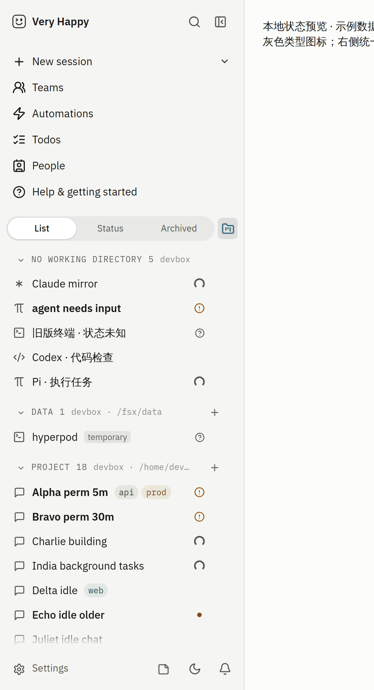
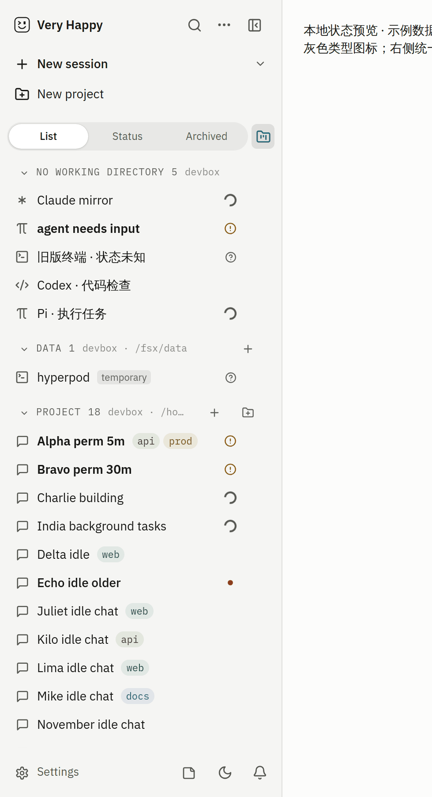
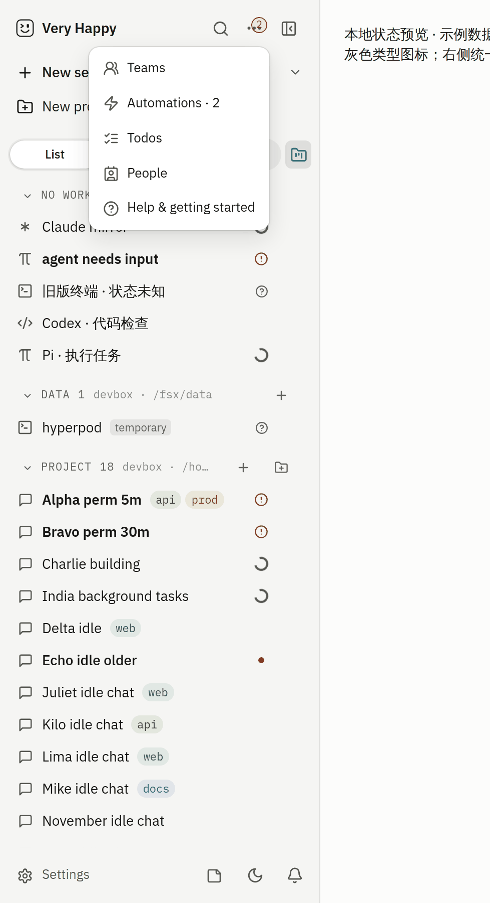
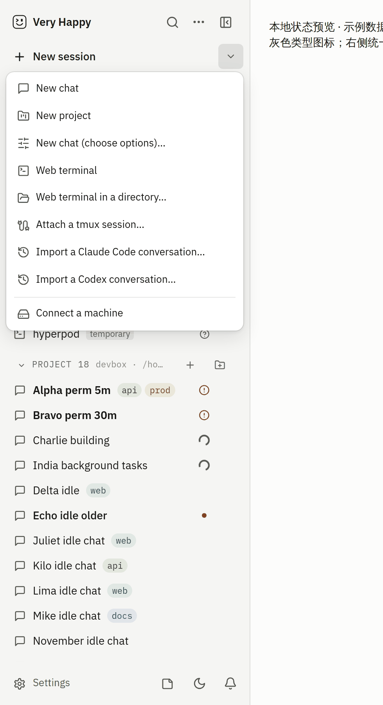
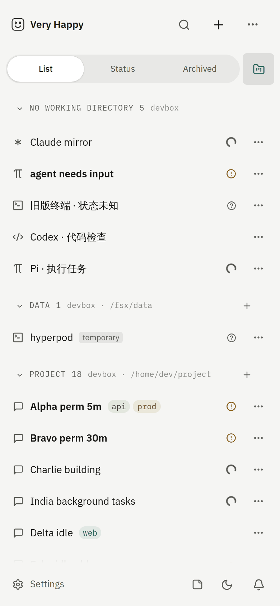
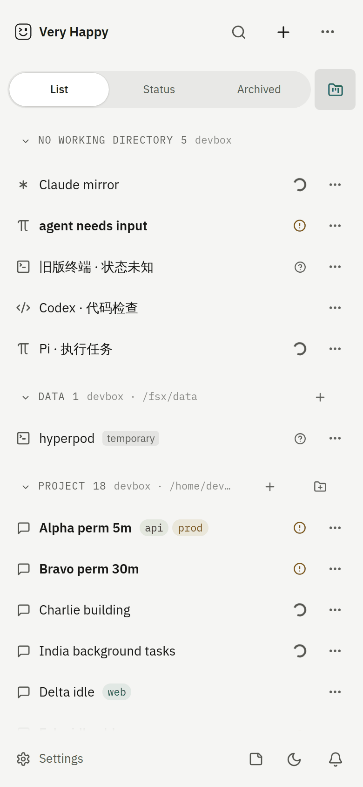
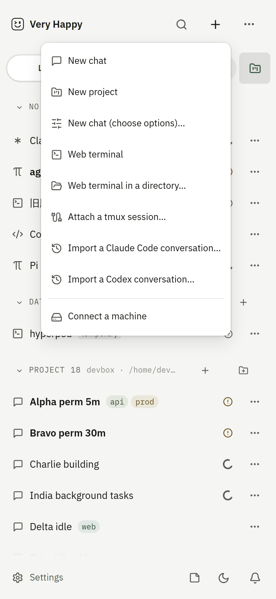
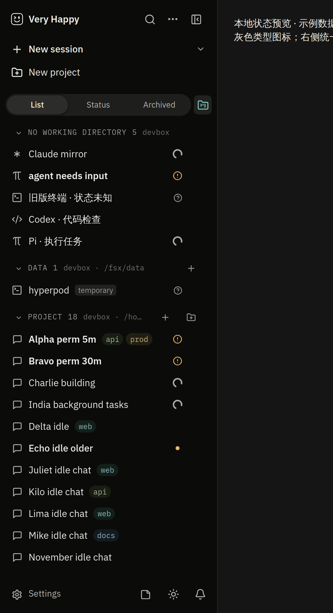

# 侧栏顶部：按钮更少，新建会话与新建项目一眼可见

> 状态：Final（随实现同 PR）
> 日期：2026-10-21 ｜ 关联 backlog：B-676 ｜ 出处：Owner 10-21「侧栏顶部按钮太多，新建项目入口也不明显」；Lead 授权按证据定方案
> 前置：B-641（手机侧栏，[spec](2026-10-mobile-sidebar.md)）、B-647/B-648（项目分组与项目页，[spec](2026-10-projects.md) §6）、B-650（会话搜索）、B-653（菜单项 44px）。本改动在它们的基础上做，不回退其效果。

## 目标

- 桌面侧栏顶部常驻按钮明显变少，列表拿回高度。
- 「新建会话」「新建项目」都一步可达、一眼能看到（带文字，不藏在菜单里）。
- 低频入口收进菜单；需要用户处理的计数不因收起而消失。
- 手机保持 B-641 的会话行数优势（顶部不加行）。
- 遵守 design-language（1-Border Rule、只用 token、触屏 44px）和改动行 design lint。

## 非目标

- 不改列表工具行（列表 / 状态 / 归档、分组菜单）、底部行（设置 / 笔记 / 主题 / 通知）和收起后的桌面窄栏。
- 不改路由、⌘K、⌘⇧F、⌘N 的语义。
- 不新增可自定义导航（比如 Orca 的「Hide from sidebar」）。见取舍 3。

## 现状盘点（改前，main @ 1267e21e，代码与 `/dev/sidebar` 实测）

### 桌面（两栏，1440×900）

| # | 位置 | 控件 | 去向 | 使用频率判断（无埋点，依据见右） |
|---|---|---|---|---|
| 1 | 品牌行 | 品牌（点击打开帮助） | 原位 | 低频；整页只放一组品牌（design-language §品牌） |
| 2 | 品牌行 | 🔍 会话搜索（⌘⇧F；⌘K 另有） | 原位 | 高频（B-650 的主入口） |
| 3 | 品牌行 | ⊟ 收起侧栏 | 原位 | 中频 |
| 4 | 导航列 | ＋ 新建会话 ▾（整行是菜单：新项目、新会话、高级、终端、指定目录终端、接入 tmux、导入 Claude、导入 Codex、连接机器） | 拆成「主区直接开对话 + ▾ 完整菜单」 | **最高频**。但改前要两次点击：先开菜单，菜单第一项还是「新项目」 |
| 5 | 导航列 | 团队 | ⋯ 菜单 | 中频。团队本身已作为行嵌在列表里（B-480/B-647），这个入口主要用来新建团队、看总览 |
| 6 | 导航列 | 自动化（危险色计数徽标） | ⋯ 菜单（计数上浮到 ⋯ 角标） | 中低频。需要决策时靠徽标提醒 |
| 7 | 导航列 | 待办 | ⋯ 菜单 | 中低频 |
| 8 | 导航列 | 联系人（好友请求计数） | ⋯ 菜单 | 低频（会话共享才用） |
| 9 | 导航列 | 帮助与入门 | ⋯ 菜单（另由品牌直达） | 低频，且与 #1 重复 |
| — | 菜单内 | 新建项目 | 独立一行「新建项目」 | 项目刚上线（B-644~649），Owner 要求鼓励使用，但入口藏在新建菜单里 |

实测：常驻可点控件 **9 个**（含品牌）；列表上方共 **7 行**；列表从 y=322px 开始，高 523px（视口的 58.1%），首屏完整可见 **12 行**。

### 手机（单栏，390×844，`pointer: coarse`）

B-641 后品牌行是：品牌 · 🔍 · ＋（创建菜单）· ⋯（团队/自动化/待办/联系人/帮助）。常驻 **4 个**；列表 660px（78.2%），首屏完整可见 11 行（harness 数据比 B-641 记录时多了分组头）。

## 竞品对照（2026-10-21 采集）

参考原图有版权风险，不进公开仓库，原图在 Owner 本机 `~/code/github/skills/tmp/vh-team-B-676/refs/`（`codex/`、`claude/`、`orca/`）。Orca 源码检出在同目录 `orca-src/`。

| | Codex 桌面（ChatGPT desktop 的 Codex 视图，2026-10） | Claude Code 桌面 / claude.ai（2026-10 current layout） | Orca（stablyai/orca @0a9980b1，源码核验） |
|---|---|---|---|
| 顶栏 | 收起侧栏、前进后退；标题行「Codex ⌄」+ 🔍 搜索 + 🔔 动态 | 收起侧栏、前进后退、Claude/Code 切换；下一行是全宽搜索框 | 标题栏：应用名、收起、前进后退 |
| 新建会话 | 第一行「New chat」，**1 次点击**（⌘N）；行尾 hover 出 Quick chat | 第一行「+ New」，**1 次点击**（⌘N） | 列表头最右的 `+` 图标，1 次点击打开新建弹窗 |
| 新建项目 | Projects 分组头 hover 出 `+`，或在新对话页的项目 chip 里选 New project（2~3 次） | 侧栏 Projects → New project（**2 次**） | 列表头的 `FolderPlus`「Add project」图标，**1 次** |
| 次级导航 | 3 个导航行（Pull requests / Scheduled / Plugins），其余收进「… Explore」 | 3~5 个导航行（Projects / Scheduled / Customize…），其余收进「··· More」 | 默认 4 个导航行（Search / Tasks / Automations / Mobile），每行可以右键隐藏 |
| 设置 / 帮助 | 侧栏底部（头像菜单、`?`） | 左下账户菜单 | 底栏（齿轮、帮助下拉） |
| 手机 | 顶栏 `≡` · 标题 · 🔍；底部常驻输入框，直接新建 | App 内 Code 标签 | 右下 FAB 新建；header 只放图标 |

观察：

1. **新建会话永远是第一行、带文字、一次点击。** 三家都没有让用户先开菜单再选「新会话」。我们改前要两次点击，而且菜单第一项是「新项目」，这是本次最直接的问题。
2. **新建项目紧挨新建会话，或者挂在项目列表头上。** Orca 用 FolderPlus 图标 1 次点击；Claude 要 2 次。我们把它做成带文字的独立一行，比两家都更醒目，符合 Owner「鼓励大家用项目」。
3. **次级导航最多常驻 3~4 行，其余进「More」，设置/帮助放底部。** 我们改前有 5 行常驻（团队/自动化/待办/联系人/帮助），加上新建一共 6 行。
4. **手机端都不在列表上方堆行。** 与 B-641 的结论一致。

## 方案取舍

| 方案 | 桌面常驻控件 | 列表上方行数 | 新建会话 | 新建项目 | 结论 |
|---|---|---|---|---|---|
| A. 维持导航列，只加「新建项目」行 | 10 | 8 | 2 次 | 1 次 | 否决：按钮更多，与目标相反 |
| B. 照 Codex：新建 + 3 个导航行（团队/自动化/待办）+「⋯ 更多」行 | 10 | 6 | 1 次 | 1 次（再加一行）或 2 次 | 否决：常驻控件不减反增，「顶部按钮明显变少」不成立 |
| C. Orca 式：新建会话、新建项目做成列表工具行里的图标 | 7 | 2 | 1 次 | 1 次 | 否决：两者都只剩图标，「一眼看到」靠认图标；工具行还要挤进分段控件 |
| **D. 品牌行 🔍 · ⋯ · ⊟；下面两行带文字：「＋ 新建会话 \| ▾」「新建项目」；次级入口全部进 ⋯（采用）** | **7** | **3** | **1 次**（▾ 2 次进其他类型） | **1 次** | 采用 |

D 的理由：

- **两个最重要的动作都是带文字的整行**，和 Codex/Claude 的第一行同构。新建会话拆成主区和 ▾：主区复用 `createChatOrConfigure`，也就是原菜单的「新会话」（按记住的机器和目录直接开，判断不了时回落到完整对话框）；▾ 保留全部 9 种创建方式，菜单按整行宽度左对齐（design-language B-435 条款）。
- **次级入口进 ⋯，与手机共用同一份 `sidebarNavEntries()`**：两端菜单内容、顺序、可见性门、计数完全一致，只多了桌面的 ⊟。⋯ 角标是待处理总数（自动化待决策 + 好友请求），菜单项带「· N」，所以收起后不会漏掉需要处理的事（B-641 机制原样复用）。
- **帮助仍一步可达**：品牌行本来就直达帮助，⋯ 里再放一个。团队和待办变成两次点击（⋯ → 项），见取舍 2。
- 列表工具行和底部行不动，B-647/B-675 的分组菜单、B-650 的搜索都不受影响。

### 取舍 1：手机为什么不加「新建项目」图标

手机品牌行已经是 品牌 · 🔍 · ＋ · ⋯。320px 宽时，16px 边距加 3 个 44px 图标已经占满（288px 可用，品牌约 140px + 132px）。再加第 4 个图标会挤压品牌或换行，加一行又违背 B-641。所以手机上新建项目放在 ＋ 菜单第二项（第一项是新会话），步数与改前的新建会话一致：一次点击打开菜单，第二次点击执行。

### 取舍 2：团队 / 自动化 / 待办从常驻变成两次点击

- 团队：已有团队都作为行嵌在列表里（点团队名进团队页）。这个入口的剩余用途是新建团队和看总览，频率低于打开某个团队。
- 自动化：真正需要注意的时刻（有待决策的运行）由 ⋯ 角标和菜单项计数提示，与 B-641 手机端一致。
- 待办：⌘K 命令面板也能打开。
- 代价：习惯点导航列的人要多点一次。可逆：将来要固定某项，只需给 `sidebarTopModel` 加一项。

### 取舍 3：不做「用户自定义固定哪些入口」

Orca 允许逐行隐藏，但这需要新的设置字段、迁移和设置页 UI。本次目标是减少按钮，先不扩大配置面。观察一段时间后再决定。

## 实现

- `sidebarNavEntries.ts`：新增纯函数 `sidebarTopModel({ isDesktop, projectsReady })`。桌面返回 `header: [search, more, collapse]`、`actions: [new-session, new-project?]`；手机返回 `header: [search, create-menu, more]`、`actions: []`。另有 `orderCreateMenu()`，让创建菜单的顺序固定为新会话、新项目、其余。
- `Sidebar.tsx`：品牌行和动作行按模型渲染。删掉桌面导航列 `nav.sb-products`。新建会话拆成 `.sb-new-main`（直接开对话）和 `.sb-new-more`（▾，完整创建菜单，`contentMinWidth` 等于整行宽度）。「新建项目」行调用现有的 `createNamedProject`，只在 projects API 返回 ready 后出现。
- `ui/Menu.tsx`：`ActionDropdownMenu` 新增可选 `contentMinWidth`。
- `sidebar.css`：`.sb-actions` / `.sb-new-split`，行高和留白沿用原导航列（桌面 32px，coarse 44px，▾ 在 coarse 下宽 44px）。没有新增描边，只用 token。
- 落地页的工作台示意（`ProductWorkspacePreview`）同步成新顶部结构。
- 文案：`sidebar.newMenu`（「更多新建方式」/ More ways to create）；中文 `sidebar.newProject` 改为「新建项目」，与「新建会话」对齐。

## 兼容矩阵与发布顺序

纯 Web 视觉与交互改动，无协议、存储或设置变化；随正常 server/Web 镜像发布，回滚即回滚镜像。

## 验收（`/dev/sidebar` 真实 Sidebar + 示例数据，Playwright + Chromium）

| 指标 | 桌面 1440×900 改前 | 桌面改后 | 手机 390×844 coarse 改前 | 手机改后 |
|---|---|---|---|---|
| 顶部常驻可点控件（含品牌） | **9** | **7** | 4 | 4 |
| 列表上方行数（品牌行 + 导航/动作行） | 7 | **3** | 1 | 1 |
| 列表起点 / 高度 | 322px / 523px（58.1%） | 178px / **667px（74.1%）** | 124px / 660px（78.2%） | 不变 |
| 首屏完整可见行 | 12 | **17** | 11 | 11 |
| 新建会话 | 2 次点击 | **1 次** | 2 次（＋ → 新会话） | 2 次（不变） |
| 新建项目 | 2 次（藏在菜单） | **1 次，带文字** | 2 次 | 2 次（＋ 菜单第二项） |
| 横向滚动 | 0 | 0 | 0 | 0 |

逐个入口验证（两种尺寸各跑一遍，结果见 PR）：

- [x] ⋯ 菜单 5 项依次打开 `/teams`、`/automations`、`/todos`、`/people`、`/help`。桌面菜单行 35px，coarse 下 44px。
- [x] 自动化有 2 条待决策时，⋯ 角标显示 2，aria-label 为「More · 2」，菜单项为「Automations · 2」。
- [x] 新建会话主区点一下进入新对话流程（harness 无法直接 spawn，回落到配置对话框，与改前菜单「新会话」行为相同）。
- [x] ▾ 打开完整创建菜单，9 项，顺序：新会话、新项目、高级…、终端、指定目录终端、接入 tmux、导入 Claude、导入 Codex、连接机器。菜单宽 303px 等于整行宽 303px，左边缘对齐。
- [x] 新建项目打开命名对话框。
- [x] 手机 ＋ 菜单前两项为新会话、新项目。
- [x] 🔍 仍打开会话搜索；⊟ 仍收起侧栏。
- [x] 明暗两套主题截图；design lint 0。

截图（示例数据）：

| 桌面改前 | 桌面改后 | 桌面 ⋯ 菜单（待决策 2） | 桌面 ▾ 创建菜单 |
|---|---|---|---|
|  |  |  |  |

| 手机改前 | 手机改后（不变） | 手机 ＋ 菜单 | 桌面暗色 |
|---|---|---|---|
|  |  |  |  |

## 风险

1. 习惯点导航列「团队」「待办」的人需要重新找入口。缓解：⋯ 与手机同位置同内容；团队行仍在列表里；⌘K 可达；本条写进更新说明。
2. 新建会话主区「直接开」与改前「先开菜单」行为不同，可能误开对话。缓解：主区与改前菜单里的「新会话」完全同一路径（判断不了时回落到对话框）；按钮带 ▾ 区分，其他类型仍在 ▾。
3. 触屏笔记本（桌面布局 + coarse）：动作行和 ▾ 的命中区按 coarse 规则放大到 44px。
